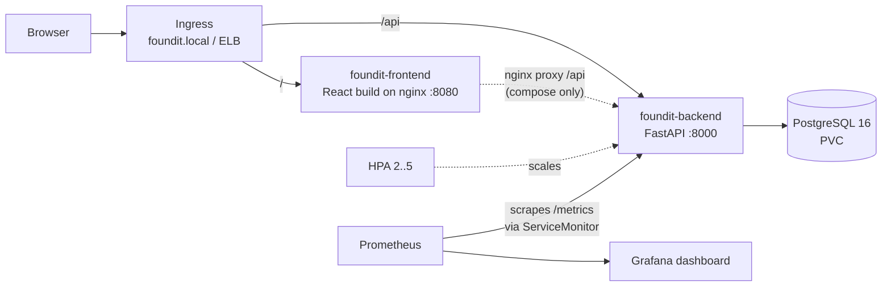
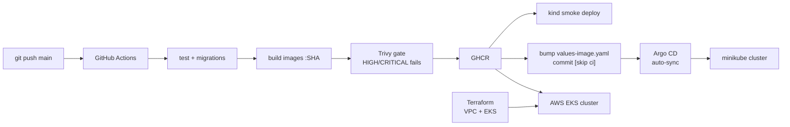

FoundIt – Design Reference
==========================

Name: Anshul Mohanty    Roll No: 24BCS10191    Section: A

This is the **reference document** for the capstone: what FoundIt is, how it is put together, and *why* each
choice was made. It is updated at the end of every build phase. For what I learned along the way, see
[LEARNING.md](LEARNING.md). For how to run things, see [README.md](README.md).

## 1. What FoundIt is

A **campus lost & found board**. A student who loses something (ID card, bottle, charger, book…) posts a
**LOST** report; a student who finds something posts a **FOUND** report. Anyone can browse and filter the
board. When the item gets back to its owner, the report is marked **RETURNED**.

```
OPEN ──► CLAIMED ──► RETURNED
  └───────────────────►┘   (the "resolve" action jumps straight to RETURNED)
```

The app is deliberately small, so that the marks go to the DevOps layer: one table, plain CRUD, filters, a
resolve action and a stats endpoint. It is clearly a different domain from the TaskBoard demo (different
model, different UI, filters, resolve flow, business metrics).

## 2. Architecture





## 3. Data model

One table, `items`.

| Column | Type | Notes |
|---|---|---|
| `id` | integer PK | |
| `title` | varchar(120) | required, 1–120 chars |
| `description` | text | default `""` |
| `type` | varchar(10) | `LOST` or `FOUND` |
| `category` | varchar(20) | `ELECTRONICS`, `ID_CARD`, `BOOKS`, `BOTTLE`, `CLOTHING`, `OTHER` |
| `location` | varchar(120) | where it was lost/found |
| `reported_by` | varchar(80) | name of the reporter |
| `contact` | varchar(120) | phone/email, default `""` |
| `status` | varchar(10) | `OPEN`, `CLAIMED`, `RETURNED` |
| `created_at` | timestamptz | set by the app |
| `resolved_at` | timestamptz, nullable | set by the resolve action (migration 0002) |

**Migrations (Alembic):**

| Revision | What it does | Why it exists |
|---|---|---|
| `0001_create_items` | creates `items` without `resolved_at` | the first version of the schema |
| `0002_add_resolved_at` | adds the nullable `resolved_at` column | shows a schema evolving safely on a live table |

## 4. API

| Method | Path | Purpose |
|---|---|---|
| GET | `/` | service name + version |
| GET | `/health` | liveness – the process is alive |
| GET | `/ready` | readiness – runs a DB query; fails if Postgres is unreachable |
| GET | `/metrics` | Prometheus metrics |
| GET | `/docs` | Swagger UI |
| GET | `/api/items?type=&status=&category=&q=` | list, newest first, with filters; `q` searches title/description/location |
| GET | `/api/items/stats` | open lost, open found, returned, total, counts by category |
| GET | `/api/items/{id}` | one item (404 if missing) |
| POST | `/api/items` | create (201); 422 on invalid enums or empty title |
| PUT | `/api/items/{id}` | partial update |
| POST | `/api/items/{id}/resolve` | sets `RETURNED` + `resolved_at` |
| DELETE | `/api/items/{id}` | delete (204) |

**Custom metrics** (on top of the instrumentator's HTTP metrics):

| Metric | Type | Meaning |
|---|---|---|
| `foundit_items_reported_total{type}` | counter | reports created, split LOST/FOUND |
| `foundit_items_resolved_total` | counter | items marked returned |
| `foundit_items_open{type}` | gauge | open items right now (refreshed on `/api/items/stats`) |

## 5. Repository layout

| Path | What lives there |
|---|---|
| `backend/` | FastAPI app, Alembic migrations, pytest suite, Dockerfile |
| `frontend/` | React + Vite UI, nginx template, Dockerfile |
| `docker-compose.yml` | postgres + backend + frontend on one machine |
| `.github/workflows/ci-cd.yml` | the pipeline |
| `k8s/` | namespace manifest |
| `helm/foundit/` | the Helm chart + values per environment |
| `monitoring/` | kube-prometheus-stack values, Grafana dashboard, alert rules |
| `argocd/` | Argo CD Application (GitOps) |
| `troubleshooting/` | deliberately broken manifests + [lab guide](troubleshooting/README.md) |
| `terraform/` | AWS VPC + EKS |
| `scripts/` | helper scripts (load test) |
| `.trivyignore` | accepted Trivy findings, each with its reason |
| `docs/screenshots/` | evidence for the grading checklist |

## 6. Config and secrets

| Setting | Where | Value / source |
|---|---|---|
| `DATABASE_URL` | backend env | compose: literal; k8s: built from the Postgres Secret |
| `BACKEND_URL` | frontend env | nginx proxy target (`http://backend:8000` in compose) |
| ports | | backend 8000, frontend 8080 in the container (3000 on the host), postgres 5432 |
| images | GHCR | `ghcr.io/anshulmohanty/foundit-backend:<sha>`, `…/foundit-frontend:<sha>` |
| AWS keys | `~/.aws` on my machine only | **never** in git |
| `terraform.tfvars` | local only | `.gitignore`d; `terraform.tfvars.example` is committed |

## 7. Decision log

| # | Decision | Why |
|---|---|---|
| D1 | Build in this repo, reuse my fixed topic-20 code, not the teacher's raw files | the teacher's Terraform does not parse and the demo had bugs I had already fixed |
| D2 | All manual work (GitHub push, GHCR visibility, AWS) is the last phase | everything that costs money or is public happens once, in one short window |
| D3 | Enums as pydantic `Literal`s, stored as plain strings | invalid values are rejected with 422 before any DB call, and the DB stays portable (SQLite in tests, Postgres in prod) |
| D4 | `/ready` runs a real query and returns 503 on failure; `/health` never touches the DB | a DB outage takes pods *out of the Service* (readiness) instead of restarting them in a loop (liveness) |
| D5 | `/api/items/stats` is declared before `/api/items/{item_id}` | FastAPI matches routes in order; otherwise `stats` would be parsed as an id and return 422 |
| D6 | Resolve is a separate `POST …/resolve` that returns 409 if already returned | it is an *action*, not a field edit; it sets `resolved_at` and counts exactly once |
| D7 | `/metrics`, `/health`, `/ready` are excluded from the HTTP metrics | probe and scrape traffic would otherwise dominate requests/s and hide real usage |
| D8 | `foundit_items_open` gauge is recomputed from the DB after every change | a gauge must be correct after a pod restart; counters only need to go up |
| D9 | `APP_VERSION` comes from an env var and is shown by `GET /` | the live demo needs a visible change that does not require a code edit in the backend |
| D10 | Migration 0002 adds `resolved_at` as a **nullable** column with no default | adding a nullable column is metadata-only in Postgres: no table rewrite, no lock, safe on a live table |
| D11 | The model declares the same index as migration 0001, and CI runs `alembic check` | models and migrations cannot silently drift apart |
| D12 | Tests run on a temp SQLite file set in `conftest.py` before the app is imported | fast, no Postgres needed for unit tests; real-Postgres behaviour is covered by the CI migrations job |
| D13 | Tests assert *deltas* (before/after) for stats and metrics, never absolute totals | the session-scoped DB is shared by all tests, so absolute counts would depend on test order |
| D14 | The browser only calls relative `/api/...` URLs | the same build works under Vite's dev proxy, nginx in compose and the Ingress in Kubernetes – no API URL is baked into the bundle |
| D15 | Filtering and search happen on the server (query params), with a 250 ms debounce on search | it exercises the API filters and stays correct as the list grows |
| D16 | UI version comes from `package.json` via Vite `define` and is shown in the footer | bumping it is a one-line, visible change for the live GitOps demo |
| D17 | Both images run as non-root (backend uid 10001, frontend nginx-unprivileged uid 101 on :8080) | least privilege; also required by clusters that enforce `runAsNonRoot` |
| D18 | Frontend is multi-stage: Node builds, only `dist/` is copied into nginx | 90 MB image with no Node/npm/source inside – less to patch, less for Trivy to flag |
| D19 | Backend CMD is `alembic upgrade head && exec uvicorn …` | every new image brings its schema; `exec` makes uvicorn PID 1 so it receives SIGTERM and shuts down cleanly |
| D20 | Compose waits on healthchecks (`service_healthy`), not just container start | Alembic would crash if Postgres were still initialising |
| D21 | Trivy gate = `HIGH,CRITICAL` + `--ignore-unfixed` + `--exit-code 1` | fail on serious issues I can actually fix by rebuilding; unfixed CVEs would block every build without any action possible |
| D22 | Tag = full commit SHA, never `latest` | every running pod can be traced to the exact commit; rollback = previous SHA |
| D23 | Separate `migrations` job with a Postgres *service container* | unit tests use SQLite; this proves the real migration scripts on the real database engine |
| D24 | Push/deploy/bump only on `main` pushes; PRs stop after the scan | PRs get full feedback without publishing anything |
| D25 | `smoke-deploy` installs the chart on a throwaway kind cluster with the images just pushed | proves the chart + images start and answer before anything is promoted |
| D26 | CD is GitOps: CI commits the new tag to `values-image.yaml`, Argo CD syncs the cluster | CI needs no cluster credentials; git is the audit log of what ran when; rollback = `git revert` |
| D27 | `concurrency` group per branch | two runs on main can never push competing bump commits |
| D28 | Trivy `config` scan of the chart and Terraform is report-only | misconfig findings are advice to review; a CVE in a shipped image is a hard stop |
| D29 | Recommended `app.kubernetes.io/*` labels; selectors use only name + instance + component | a Deployment selector is immutable – keeping it minimal means a chart/app version bump never breaks upgrades |
| D30 | `values.yaml` (defaults) + `values-<env>.yaml` (environment) + `values-image.yaml` (tags, owned by CI) | the only file CI ever edits is the one with tags, so a bump commit can't change anything else |
| D31 | HPA enabled ⇒ the Deployment omits `replicas` | otherwise every sync/upgrade resets the count and fights the HPA |
| D32 | Backend: startup + liveness on `/health`, readiness on `/ready`; frontend probes nginx's own `/healthz` | migrations get time to run; a DB outage removes backend pods from the Service instead of restarting them; a backend outage never restarts the UI |
| D33 | Pod security: non-root uid, `allowPrivilegeEscalation: false`, drop ALL capabilities, seccomp RuntimeDefault; backend also `readOnlyRootFilesystem` | least privilege; the backend writes nothing to disk |
| D34 | `maxUnavailable: 0, maxSurge: 1` + PodDisruptionBudget `minAvailable: 1` | rolling updates and node drains never take the API to zero |
| D35 | Postgres as a single-replica Deployment with a `Recreate` strategy, PVC kept on uninstall (`helm.sh/resource-policy: keep`) | an RWO volume can only be mounted by one pod; deleting the release must not delete the data. Production would use RDS. |
| D36 | Ingress with an optional host (`foundit.local` on minikube, none on EKS) | the EKS load balancer has a generated hostname that is not known in advance |
| D37 | Init container `wait-for-postgres` runs `pg_isready -U <user>` | avoids a CrashLoopBackOff race on first install; `-U` is needed because uid 10001 has no user name |
| D38 | kube-prometheus-stack with Alertmanager, default rules/dashboards, API-server and CoreDNS scraping off; Grafana without sidecars | the stock install pushed the 2.7 GiB node to 92% memory and probes failed cluster-wide; these parts cost the most and the project doesn't use them |
| D39 | The node's real limit is the minikube container (2.73 GiB), but it reports the Docker VM's 3.6 GiB | the kubelet never sees memory pressure, so it never evicts – it just thrashes. Requests/limits must be sized by hand for the real 2.7 GiB |
| D40 | Grafana `GOMEMLIMIT=420MiB` under a 512Mi limit | the Go GC works harder near the limit instead of being OOMKilled (it was OOMKilled at 256Mi and 384Mi) |
| D41 | Dashboard + datasource provisioned from files (`dashboardsConfigMaps`), dashboard JSON generated from a script | dashboards are code, reviewed in git; no sidecar watching every ConfigMap |
| D42 | Alert rules as a `PrometheusRule`: backend down, 5xx > 5%, p95 > 1 s, HPA at max | each one answers "should a human look now?"; the HPA-at-max rule says scaling has run out of room |
| D43 | Load test runs inside the cluster, light (6 clients) | no port-forward bottleneck; a heavier test starved the single node |
| D44 | HPA max 3 on minikube, scale-down stabilization 120 s | the node fits 3 backends next to monitoring; 120 s (default 300 s) shows the full up-and-down cycle in a demo |
| D45 | The app starts even when the DB is unreachable; `/ready` returns 503 and logs the driver's message | a DB outage removes pods from rotation with a clear log line instead of a CrashLoopBackOff; found while building lab 3 |
| D46 | Troubleshooting labs are standalone `foundit-lab-*` objects next to the release | they can be broken and fixed live without touching the real deployment (or confusing Argo CD) |
| D47 | Terraform uses the community VPC (5.8.1) and EKS (20.37.1) modules, AWS provider 5.x, local state | versions already proven in topic 20; local state is fine for one person and one short window (S3 + lockfile for a team) |
| D48 | One NAT gateway, 2 AZs, nodes in private subnets, load balancers in public subnets | the NAT gateway is the most expensive VPC part; one AZ outage is an accepted risk for a demo |
| D49 | EKS addons managed by Terraform: vpc-cni, coredns, kube-proxy, **aws-ebs-csi-driver with an IRSA role**, metrics-server | without the EBS CSI driver the Postgres PVC stays Pending; IRSA gives volume permissions to one service account instead of every node |
| D50 | `api_allowed_cidrs` has no default and rejects `0.0.0.0/0` | the EKS API is public (kubectl from my laptop) but only to my IP; nobody can open it to the internet by accident |
| D51 | Pods use read-only root filesystems (backend, frontend, init container, postgres) with `emptyDir` for the paths that must be writable; postgres runs as uid 70 | a compromised process can't modify its own image; found by the Trivy config scan |
| D52 | `.trivyignore` holds accepted findings, each with a written reason; CI's config scan skips the deliberately broken labs | accepted risk is documented and reviewable instead of silently ignored |
| D53 | Argo CD installed lean (no Dex, notifications or ApplicationSet), polls every 60 s; Application uses automated sync + prune + selfHeal | fits next to the app and monitoring; the live demo doesn't wait 3 minutes; manual drift is reverted |

## 8. Phase status

| Phase | What | Status | Evidence |
|---|---|---|---|
| 1 | Scaffold, DESIGN.md, LEARNING.md | ✅ done | this file |
| 2 | Backend | ✅ done | [API calls](docs/screenshots/02_backend_api.png), [Swagger](docs/screenshots/03_swagger.png) |
| 3 | Alembic migrations | ✅ done | [up/down/up + check](docs/screenshots/04_migrations.png) |
| 4 | Tests | ✅ done – 22 passing | [pytest -v](docs/screenshots/05_pytest.png) |
| 5 | Frontend | ✅ done | [board](docs/screenshots/06_ui_board.png), [report modal](docs/screenshots/07_ui_report_modal.png), [API down](docs/screenshots/08_ui_backend_down.png) |
| 6 | Docker + Compose | ✅ done | [compose up + psql + non-root](docs/screenshots/09_compose_up.png), [UI on :3000](docs/screenshots/10_ui_compose.png), [Trivy](docs/screenshots/11_trivy_local.png) |
| 7 | CI/CD workflow | ✅ written + actionlint clean (first real run in Phase 12A) | [jobs + actionlint](docs/screenshots/12_ci_workflow_lint.png) |
| 8 | Helm + minikube | ✅ done | [helm + kubectl](docs/screenshots/13_helm_minikube.png), [UI via Ingress](docs/screenshots/14_ui_ingress.png) |
| 9 | Monitoring + HPA | ✅ done | [targets UP](docs/screenshots/15_prometheus_targets.png), [alert rules](docs/screenshots/16_prometheus_alerts.png), [Grafana](docs/screenshots/17_grafana_dashboard.png), [HPA 2→3→2](docs/screenshots/18_hpa_scaling.png) |
| 10 | Troubleshooting labs | ✅ done | [ImagePullBackOff](docs/screenshots/19_lab_broken_image.png), [no endpoints](docs/screenshots/20_lab_broken_service.png), [never Ready](docs/screenshots/21_lab_broken_readiness.png) |
| 11 | Terraform + Argo CD + README | ✅ code done (Argo CD sync tested in 12B, AWS in 12C) | [validate + IaC scan](docs/screenshots/22_terraform_validate.png), [/metrics](docs/screenshots/23_metrics_endpoint.png) |
| 12 | Guided manual phase: push, GHCR, GitOps demo, AWS | ⏳ | |
