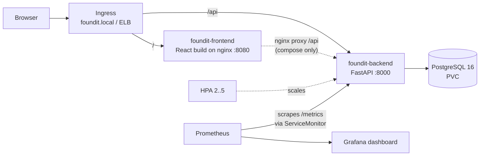
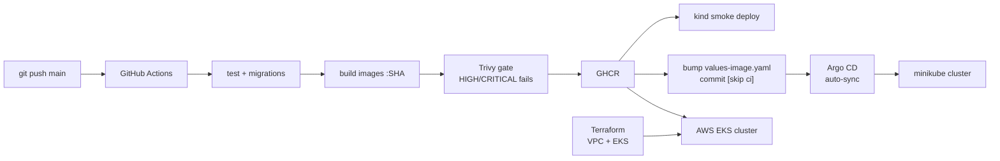

FoundIt – Design Reference
==========================

Name: Anshul Mohanty    Roll No: 24BCS10191    Section: A

This is the **reference document** for the capstone: what FoundIt is, how it is put together, and *why* each
choice was made. It is updated at the end of every build phase. For what I learned along the way, see
[LEARNING.md](LEARNING.md). For how to run things, see [README.md](README.md).

## 1. What FoundIt is

A **campus lost & found board**. A student who loses something (ID card, bottle, charger, book…) posts a
**LOST** report; a student who finds something posts a **FOUND** report. Anyone can browse and filter the
board. When the item gets back to its owner, the report is marked **RETURNED**.

```
OPEN ──► CLAIMED ──► RETURNED
  └───────────────────►┘   (the "resolve" action jumps straight to RETURNED)
```

The app is deliberately small, so that the marks go to the DevOps layer: one table, plain CRUD, filters, a
resolve action and a stats endpoint. It is clearly a different domain from the TaskBoard demo (different
model, different UI, filters, resolve flow, business metrics).

## 2. Architecture





## 3. Data model

One table, `items`.

| Column | Type | Notes |
|---|---|---|
| `id` | integer PK | |
| `title` | varchar(120) | required, 1–120 chars |
| `description` | text | default `""` |
| `type` | varchar(10) | `LOST` or `FOUND` |
| `category` | varchar(20) | `ELECTRONICS`, `ID_CARD`, `BOOKS`, `BOTTLE`, `CLOTHING`, `OTHER` |
| `location` | varchar(120) | where it was lost/found |
| `reported_by` | varchar(80) | name of the reporter |
| `contact` | varchar(120) | phone/email, default `""` |
| `status` | varchar(10) | `OPEN`, `CLAIMED`, `RETURNED` |
| `created_at` | timestamptz | set by the app |
| `resolved_at` | timestamptz, nullable | set by the resolve action (migration 0002) |

**Migrations (Alembic):**

| Revision | What it does | Why it exists |
|---|---|---|
| `0001_create_items` | creates `items` without `resolved_at` | the first version of the schema |
| `0002_add_resolved_at` | adds the nullable `resolved_at` column | shows a schema evolving safely on a live table |

## 4. API

| Method | Path | Purpose |
|---|---|---|
| GET | `/` | service name + version |
| GET | `/health` | liveness – the process is alive |
| GET | `/ready` | readiness – runs a DB query; fails if Postgres is unreachable |
| GET | `/metrics` | Prometheus metrics |
| GET | `/docs` | Swagger UI |
| GET | `/api/items?type=&status=&category=&q=` | list, newest first, with filters; `q` searches title/description/location |
| GET | `/api/items/stats` | open lost, open found, returned, total, counts by category |
| GET | `/api/items/{id}` | one item (404 if missing) |
| POST | `/api/items` | create (201); 422 on invalid enums or empty title |
| PUT | `/api/items/{id}` | partial update |
| POST | `/api/items/{id}/resolve` | sets `RETURNED` + `resolved_at` |
| DELETE | `/api/items/{id}` | delete (204) |

**Custom metrics** (on top of the instrumentator's HTTP metrics):

| Metric | Type | Meaning |
|---|---|---|
| `foundit_items_reported_total{type}` | counter | reports created, split LOST/FOUND |
| `foundit_items_resolved_total` | counter | items marked returned |
| `foundit_items_open{type}` | gauge | open items right now (refreshed on `/api/items/stats`) |

## 5. Repository layout

| Path | What lives there |
|---|---|
| `backend/` | FastAPI app, Alembic migrations, pytest suite, Dockerfile |
| `frontend/` | React + Vite UI, nginx template, Dockerfile |
| `docker-compose.yml` | postgres + backend + frontend on one machine |
| `.github/workflows/ci-cd.yml` | the pipeline |
| `k8s/` | namespace manifest |
| `helm/foundit/` | the Helm chart + values per environment |
| `monitoring/` | kube-prometheus-stack values, Grafana dashboard, alert rules |
| `argocd/` | Argo CD Application (GitOps) |
| `troubleshooting/` | deliberately broken manifests for the debugging labs |
| `terraform/` | AWS VPC + EKS |
| `scripts/` | helper scripts (load test) |
| `docs/screenshots/` | evidence for the grading checklist |

## 6. Config and secrets

| Setting | Where | Value / source |
|---|---|---|
| `DATABASE_URL` | backend env | compose: literal; k8s: built from the Postgres Secret |
| `BACKEND_URL` | frontend env | nginx proxy target (`http://backend:8000` in compose) |
| ports | | backend 8000, frontend 8080 in the container (3000 on the host), postgres 5432 |
| images | GHCR | `ghcr.io/anshulmohanty/foundit-backend:<sha>`, `…/foundit-frontend:<sha>` |
| AWS keys | `~/.aws` on my machine only | **never** in git |
| `terraform.tfvars` | local only | `.gitignore`d; `terraform.tfvars.example` is committed |

## 7. Decision log

| # | Decision | Why |
|---|---|---|
| D1 | Build in this repo, reuse my fixed topic-20 code, not the teacher's raw files | the teacher's Terraform does not parse and the demo had bugs I had already fixed |
| D2 | All manual work (GitHub push, GHCR visibility, AWS) is the last phase | everything that costs money or is public happens once, in one short window |
| D3 | Enums as pydantic `Literal`s, stored as plain strings | invalid values are rejected with 422 before any DB call, and the DB stays portable (SQLite in tests, Postgres in prod) |
| D4 | `/ready` runs a real query and returns 503 on failure; `/health` never touches the DB | a DB outage takes pods *out of the Service* (readiness) instead of restarting them in a loop (liveness) |
| D5 | `/api/items/stats` is declared before `/api/items/{item_id}` | FastAPI matches routes in order; otherwise `stats` would be parsed as an id and return 422 |
| D6 | Resolve is a separate `POST …/resolve` that returns 409 if already returned | it is an *action*, not a field edit; it sets `resolved_at` and counts exactly once |
| D7 | `/metrics`, `/health`, `/ready` are excluded from the HTTP metrics | probe and scrape traffic would otherwise dominate requests/s and hide real usage |
| D8 | `foundit_items_open` gauge is recomputed from the DB after every change | a gauge must be correct after a pod restart; counters only need to go up |
| D10 | Migration 0002 adds `resolved_at` as a **nullable** column with no default | adding a nullable column is metadata-only in Postgres: no table rewrite, no lock, safe on a live table |
| D11 | The model declares the same index as migration 0001, and CI runs `alembic check` | models and migrations cannot silently drift apart |
| D9 | `APP_VERSION` comes from an env var and is shown by `GET /` | the live demo needs a visible change that does not require a code edit in the backend |

## 8. Phase status

| Phase | What | Status | Evidence |
|---|---|---|---|
| 1 | Scaffold, DESIGN.md, LEARNING.md | ✅ done | this file |
| 2 | Backend | ✅ done | [API calls](docs/screenshots/02_backend_api.png), [Swagger](docs/screenshots/03_swagger.png) |
| 3 | Alembic migrations | ✅ done | [up/down/up + check](docs/screenshots/04_migrations.png) |
| 4 | Tests | ⏳ | |
| 5 | Frontend | ⏳ | |
| 6 | Docker + Compose | ⏳ | |
| 7 | CI/CD workflow | ⏳ | |
| 8 | Helm + minikube | ⏳ | |
| 9 | Monitoring + HPA | ⏳ | |
| 10 | Troubleshooting labs | ⏳ | |
| 11 | Terraform + Argo CD + README | ⏳ | |
| 12 | Guided manual phase: push, GHCR, GitOps demo, AWS | ⏳ | |
