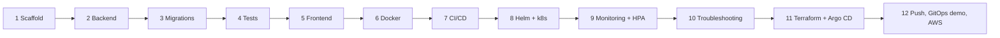

FoundIt Capstone – Learning Notes
=================================

Name: Anshul Mohanty    Roll No: 24BCS10191    Section: A

One section per build phase, written as the phase finishes. Each section has: **in one line**, **what I
built**, **concepts**, **gotchas I actually hit**, and **viva answers**. The design itself lives in
[DESIGN.md](DESIGN.md).

## The whole journey in one picture

---

## Phase 1 – Scaffold

**In one line:** decide the shape of the repo and the rules (what is never committed) before writing code.

**What I built**
- A monorepo: `backend/`, `frontend/`, `helm/`, `terraform/`, `monitoring/`… one folder per concern.
- `.gitignore` that keeps secrets and state out of git: `.env`, `*.tfstate`, `*.tfvars` (but not
  `*.tfvars.example`), `.terraform/`, `node_modules/`.
- `.gitattributes` forcing LF endings on `*.sh`.
- `DESIGN.md` (the reference) and this file.

**Concepts**

| File | Job |
|---|---|
| `.gitignore` | what git must never track |
| `.dockerignore` | what is never sent to the Docker build context (smaller, faster, no secrets in images) |
| `.gitattributes` | how git normalises files – here, line endings |

**Gotchas**
- On Windows, git can turn `\n` into `\r\n`. A shell script with `\r\n` fails on a Linux runner with
  `bad interpreter: /bin/bash^M`. `*.sh text eol=lf` prevents it.
- Terraform state is plain JSON that can contain secrets and resource IDs – it is never committed.

**Viva answers**
- *Why a monorepo?* App, infra and deployment config change together; one commit = one consistent version
  of everything, which is what GitOps needs.
- *Why ignore `*.tfvars`?* They hold my real values (region, sizes, maybe credentials); the `.example` file
  documents the shape without the values.
