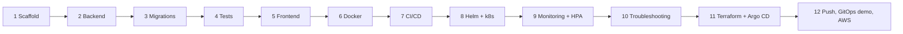
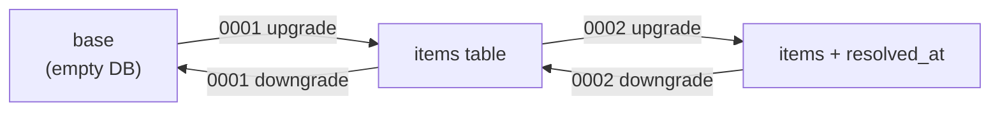

FoundIt Capstone – Learning Notes
=================================

Name: Anshul Mohanty    Roll No: 24BCS10191    Section: A

One section per build phase, written as the phase finishes. Each section has: **in one line**, **what I
built**, **concepts**, **gotchas I actually hit**, and **viva answers**. The design itself lives in
[DESIGN.md](DESIGN.md).

## The whole journey in one picture



---

## Phase 1 – Scaffold

**In one line:** decide the shape of the repo and the rules (what is never committed) before writing code.

**What I built**
- A monorepo: `backend/`, `frontend/`, `helm/`, `terraform/`, `monitoring/`… one folder per concern.
- `.gitignore` that keeps secrets and state out of git: `.env`, `*.tfstate`, `*.tfvars` (but not
  `*.tfvars.example`), `.terraform/`, `node_modules/`.
- `.gitattributes` forcing LF endings on `*.sh`.
- `DESIGN.md` (the reference) and this file.

**Concepts**

| File | Job |
|---|---|
| `.gitignore` | what git must never track |
| `.dockerignore` | what is never sent to the Docker build context (smaller, faster, no secrets in images) |
| `.gitattributes` | how git normalises files – here, line endings |

**Gotchas**
- On Windows, git can turn `\n` into `\r\n`. A shell script with `\r\n` fails on a Linux runner with
  `bad interpreter: /bin/bash^M`. `*.sh text eol=lf` prevents it.
- Terraform state is plain JSON that can contain secrets and resource IDs – it is never committed.

**Viva answers**
- *Why a monorepo?* App, infra and deployment config change together; one commit = one consistent version
  of everything, which is what GitOps needs.
- *Why ignore `*.tfvars`?* They hold my real values (region, sizes, maybe credentials); the `.example` file
  documents the shape without the values.

---

## Phase 2 – Backend (FastAPI)

**In one line:** the thing being deployed – a small REST API that also tells Kubernetes whether it is
alive, whether it is ready, and how it is doing (metrics).

**What I built**
- `app/config.py` – settings from env vars (`DATABASE_URL`, `APP_VERSION`) via pydantic-settings.
- `app/db.py` – SQLAlchemy engine + a session per request (`get_db` dependency).
- `app/models.py` – the `Item` table. `app/schemas.py` – request/response shapes with `Literal` enums.
- `app/main.py` – CRUD, filters (`type`, `status`, `category`, `q`), `POST /resolve`, `/stats`.
- `app/metrics.py` – `foundit_items_reported_total{type}`, `foundit_items_resolved_total`,
  `foundit_items_open{type}`.

```bash
py -m venv .venv && .venv/Scripts/python -m pip install -r requirements-dev.txt
DATABASE_URL=sqlite:///./dev.db .venv/Scripts/python -m uvicorn app.main:app --port 8000
curl localhost:8000/api/items/stats        # Swagger UI at http://localhost:8000/docs
```

**Concepts**

| Endpoint | Probe / user | If it fails |
|---|---|---|
| `/health` | liveness probe | kubelet **restarts** the container |
| `/ready` | readiness probe | pod is **removed from the Service** endpoints, not restarted |
| `/metrics` | Prometheus scrape | dashboards go blank, the target shows DOWN |

| Metric type | Goes | Example here |
|---|---|---|
| Counter | only up (resets on restart; `rate()` handles that) | `foundit_items_reported_total` |
| Gauge | up and down | `foundit_items_open` |
| Histogram | buckets of values → percentiles | `http_request_duration_seconds` (from the instrumentator) |

| Status code | Meaning in this API |
|---|---|
| 201 | item created |
| 204 | item deleted, no body |
| 404 | no item with that id |
| 409 | resolve on an item that is already returned |
| 422 | validation failed (empty title, `type: STOLEN`…) |
| 503 | `/ready`: database unreachable |

**Gotchas**
- Route order matters: `/api/items/stats` must come *before* `/api/items/{item_id}`.
- A liveness probe must not check the database – if Postgres blips, every pod would be restarted at once.
- Leaving probe and scrape paths in the HTTP metrics makes "requests/s" mostly kubelet and Prometheus.

**Viva answers**
- *Liveness vs readiness?* Liveness = "should I be restarted?"; readiness = "should I get traffic?". A DB
  outage is a readiness problem, not a liveness one.
- *Why custom metrics?* HTTP metrics say the service is busy; business metrics say *what* it is busy
  with (how many items are lost vs found, how many get returned).
- *Why pydantic `Literal`s?* Validation at the edge: bad input is rejected with 422 before it reaches the DB.

---

## Phase 3 – Database migrations (Alembic)

**In one line:** the database schema is versioned like code – every change is a numbered, reversible
script that runs automatically before the app starts.

**What I built**
- `0001_create_items` – the table plus an index on `(type, status)`.
- `0002_add_resolved_at` – a nullable column added later, to show a schema evolving.
- `alembic/env.py` reads `DATABASE_URL` from the same settings as the app, so there is one source of truth.

```bash
alembic history            # the chain: <base> -> 0001 -> 0002 (head)
alembic upgrade head       # apply everything not yet applied
alembic current            # which revision this database is at (stored in table alembic_version)
alembic downgrade base     # undo everything - proves each downgrade() works
alembic check              # fail if the models contain changes no migration covers
```

**Concepts**



| Approach | Good for | Problem |
|---|---|---|
| `Base.metadata.create_all()` | tests, a brand-new DB | never alters an existing table |
| Alembic migrations | every real environment | needs discipline: one script per change |

**Gotchas**
- `pg_isready` can say "ready" while the Postgres image is still running its init scripts and about to
  restart – wait a few seconds more (or use a compose healthcheck with retries).
- Adding a `NOT NULL` column without a default to a table that already has rows fails; nullable (or with a
  server default) is the safe way.
- If the model and the migrations disagree (e.g. an index only in the model), `alembic check` catches it.

**Viva answers**
- *Why not just `create_all`?* It only creates missing tables. It can never add a column to a table that
  already holds production data – migrations can, and can be rolled back.
- *Where do migrations run?* In the container command, `alembic upgrade head && uvicorn …`, so every new
  version brings its schema with it. In CI, a job runs upgrade → downgrade → upgrade on a real Postgres.
- *How does Alembic know what is applied?* The `alembic_version` table stores the current revision id.

---

## Phase 4 – Automated tests (pytest)

**In one line:** the first gate of the pipeline – if any of these 22 tests fails, nothing gets built,
scanned or deployed.

**What I built**
- `tests/conftest.py` – sets `DATABASE_URL` to a temp SQLite file *before* importing the app, a
  session-wide `TestClient` (inside `with`, so the lifespan creates the tables) and a `make_item` factory.
- `tests/test_health.py` – `/`, `/health`, `/ready`, `/metrics`.
- `tests/test_items.py` – create, 4 kinds of invalid input (422), list order, each filter, search,
  get, 404, update, resolved_at consistency, resolve + 409, delete, stats, business metrics.

```bash
pytest -v                       # locally (venv)
docker run --rm -v "$PWD:/src:ro" python:3.12-slim sh -c "cp -r /src /app && cd /app && pip install -r requirements-dev.txt && pytest -v"
```

**Concepts**

| Fixture scope | Created | Used here for |
|---|---|---|
| `session` | once per test run | the `TestClient` (and so the DB) |
| `function` (default) | once per test | `make_item` – fresh data per test |

| Test type | What it proves | Where |
|---|---|---|
| unit / API tests | the logic and the HTTP contract | pytest, every push |
| migration test | the schema scripts work on real Postgres | CI `migrations` job |
| smoke test | the deployed containers answer | CI `smoke-deploy` job (kind) |

**Gotchas**
- The env var has to be set before `from app.main import app`, because `app.db` builds the engine at
  import time – that is why the import sits below `os.environ[...]` in `conftest.py`.
- `@pytest.mark.parametrize` turned one test into four (one per bad payload) – each shows separately.
- A shared DB means tests must not assume the table is empty: compare before/after.

**Viva answers**
- *Why SQLite in tests if production is Postgres?* Speed and zero setup for logic tests. Postgres-specific
  behaviour (the migrations) is tested separately against a real Postgres service container in CI.
- *What does a failing test do in the pipeline?* The `test` job fails, and `build-scan-push` `needs` it,
  so no image is built or pushed – a broken commit never reaches a cluster.
