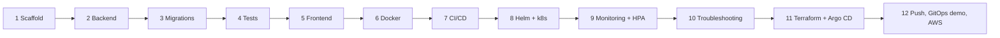
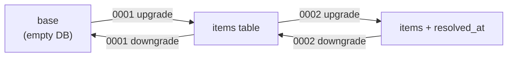
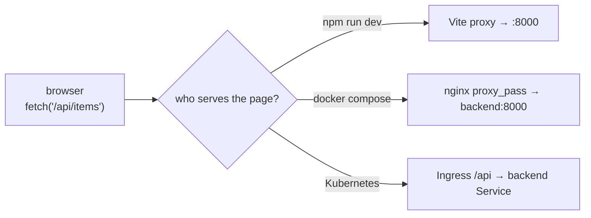
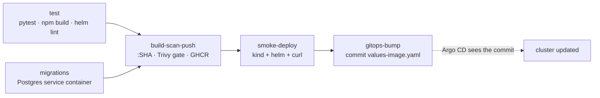
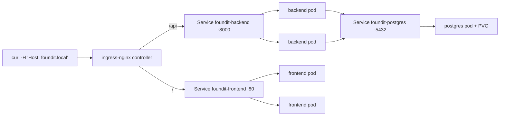
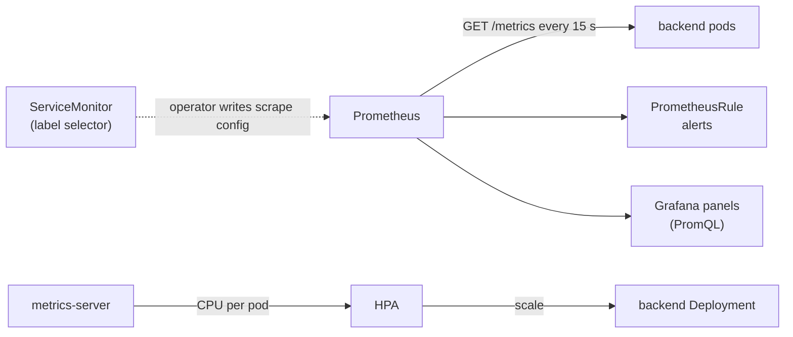

FoundIt Capstone – Learning Notes
=================================

Name: Anshul Mohanty    Roll No: 24BCS10191    Section: A

One section per build phase, written as the phase finishes. Each section has: **in one line**, **what I
built**, **concepts**, **gotchas I actually hit**, and **viva answers**. The design itself lives in
[DESIGN.md](DESIGN.md).

## The whole journey in one picture



---

## Phase 1 – Scaffold

**In one line:** decide the shape of the repo and the rules (what is never committed) before writing code.

**What I built**
- A monorepo: `backend/`, `frontend/`, `helm/`, `terraform/`, `monitoring/`… one folder per concern.
- `.gitignore` that keeps secrets and state out of git: `.env`, `*.tfstate`, `*.tfvars` (but not
  `*.tfvars.example`), `.terraform/`, `node_modules/`.
- `.gitattributes` forcing LF endings on `*.sh`.
- `DESIGN.md` (the reference) and this file.

**Concepts**

| File | Job |
|---|---|
| `.gitignore` | what git must never track |
| `.dockerignore` | what is never sent to the Docker build context (smaller, faster, no secrets in images) |
| `.gitattributes` | how git normalises files – here, line endings |

**Gotchas**
- On Windows, git can turn `\n` into `\r\n`. A shell script with `\r\n` fails on a Linux runner with
  `bad interpreter: /bin/bash^M`. `*.sh text eol=lf` prevents it.
- Terraform state is plain JSON that can contain secrets and resource IDs – it is never committed.

**Viva answers**
- *Why a monorepo?* App, infra and deployment config change together; one commit = one consistent version
  of everything, which is what GitOps needs.
- *Why ignore `*.tfvars`?* They hold my real values (region, sizes, maybe credentials); the `.example` file
  documents the shape without the values.

---

## Phase 2 – Backend (FastAPI)

**In one line:** the thing being deployed – a small REST API that also tells Kubernetes whether it is
alive, whether it is ready, and how it is doing (metrics).

**What I built**
- `app/config.py` – settings from env vars (`DATABASE_URL`, `APP_VERSION`) via pydantic-settings.
- `app/db.py` – SQLAlchemy engine + a session per request (`get_db` dependency).
- `app/models.py` – the `Item` table. `app/schemas.py` – request/response shapes with `Literal` enums.
- `app/main.py` – CRUD, filters (`type`, `status`, `category`, `q`), `POST /resolve`, `/stats`.
- `app/metrics.py` – `foundit_items_reported_total{type}`, `foundit_items_resolved_total`,
  `foundit_items_open{type}`.

```bash
py -m venv .venv && .venv/Scripts/python -m pip install -r requirements-dev.txt
DATABASE_URL=sqlite:///./dev.db .venv/Scripts/python -m uvicorn app.main:app --port 8000
curl localhost:8000/api/items/stats        # Swagger UI at http://localhost:8000/docs
```

**Concepts**

| Endpoint | Probe / user | If it fails |
|---|---|---|
| `/health` | liveness probe | kubelet **restarts** the container |
| `/ready` | readiness probe | pod is **removed from the Service** endpoints, not restarted |
| `/metrics` | Prometheus scrape | dashboards go blank, the target shows DOWN |

| Metric type | Goes | Example here |
|---|---|---|
| Counter | only up (resets on restart; `rate()` handles that) | `foundit_items_reported_total` |
| Gauge | up and down | `foundit_items_open` |
| Histogram | buckets of values → percentiles | `http_request_duration_seconds` (from the instrumentator) |

| Status code | Meaning in this API |
|---|---|
| 201 | item created |
| 204 | item deleted, no body |
| 404 | no item with that id |
| 409 | resolve on an item that is already returned |
| 422 | validation failed (empty title, `type: STOLEN`…) |
| 503 | `/ready`: database unreachable |

**Gotchas**
- Route order matters: `/api/items/stats` must come *before* `/api/items/{item_id}`.
- A liveness probe must not check the database – if Postgres blips, every pod would be restarted at once.
- Leaving probe and scrape paths in the HTTP metrics makes "requests/s" mostly kubelet and Prometheus.

**Viva answers**
- *Liveness vs readiness?* Liveness = "should I be restarted?"; readiness = "should I get traffic?". A DB
  outage is a readiness problem, not a liveness one.
- *Why custom metrics?* HTTP metrics say the service is busy; business metrics say *what* it is busy
  with (how many items are lost vs found, how many get returned).
- *Why pydantic `Literal`s?* Validation at the edge: bad input is rejected with 422 before it reaches the DB.

---

## Phase 3 – Database migrations (Alembic)

**In one line:** the database schema is versioned like code – every change is a numbered, reversible
script that runs automatically before the app starts.

**What I built**
- `0001_create_items` – the table plus an index on `(type, status)`.
- `0002_add_resolved_at` – a nullable column added later, to show a schema evolving.
- `alembic/env.py` reads `DATABASE_URL` from the same settings as the app, so there is one source of truth.

```bash
alembic history            # the chain: <base> -> 0001 -> 0002 (head)
alembic upgrade head       # apply everything not yet applied
alembic current            # which revision this database is at (stored in table alembic_version)
alembic downgrade base     # undo everything - proves each downgrade() works
alembic check              # fail if the models contain changes no migration covers
```

**Concepts**



| Approach | Good for | Problem |
|---|---|---|
| `Base.metadata.create_all()` | tests, a brand-new DB | never alters an existing table |
| Alembic migrations | every real environment | needs discipline: one script per change |

**Gotchas**
- `pg_isready` can say "ready" while the Postgres image is still running its init scripts and about to
  restart – wait a few seconds more (or use a compose healthcheck with retries).
- Adding a `NOT NULL` column without a default to a table that already has rows fails; nullable (or with a
  server default) is the safe way.
- If the model and the migrations disagree (e.g. an index only in the model), `alembic check` catches it.

**Viva answers**
- *Why not just `create_all`?* It only creates missing tables. It can never add a column to a table that
  already holds production data – migrations can, and can be rolled back.
- *Where do migrations run?* In the container command, `alembic upgrade head && uvicorn …`, so every new
  version brings its schema with it. In CI, a job runs upgrade → downgrade → upgrade on a real Postgres.
- *How does Alembic know what is applied?* The `alembic_version` table stores the current revision id.

---

## Phase 4 – Automated tests (pytest)

**In one line:** the first gate of the pipeline – if any of these 22 tests fails, nothing gets built,
scanned or deployed.

**What I built**
- `tests/conftest.py` – sets `DATABASE_URL` to a temp SQLite file *before* importing the app, a
  session-wide `TestClient` (inside `with`, so the lifespan creates the tables) and a `make_item` factory.
- `tests/test_health.py` – `/`, `/health`, `/ready`, `/metrics`.
- `tests/test_items.py` – create, 4 kinds of invalid input (422), list order, each filter, search,
  get, 404, update, resolved_at consistency, resolve + 409, delete, stats, business metrics.

```bash
pytest -v                       # locally (venv)
docker run --rm -v "$PWD:/src:ro" python:3.12-slim sh -c "cp -r /src /app && cd /app && pip install -r requirements-dev.txt && pytest -v"
```

**Concepts**

| Fixture scope | Created | Used here for |
|---|---|---|
| `session` | once per test run | the `TestClient` (and so the DB) |
| `function` (default) | once per test | `make_item` – fresh data per test |

| Test type | What it proves | Where |
|---|---|---|
| unit / API tests | the logic and the HTTP contract | pytest, every push |
| migration test | the schema scripts work on real Postgres | CI `migrations` job |
| smoke test | the deployed containers answer | CI `smoke-deploy` job (kind) |

**Gotchas**
- The env var has to be set before `from app.main import app`, because `app.db` builds the engine at
  import time – that is why the import sits below `os.environ[...]` in `conftest.py`.
- `@pytest.mark.parametrize` turned one test into four (one per bad payload) – each shows separately.
- A shared DB means tests must not assume the table is empty: compare before/after.

**Viva answers**
- *Why SQLite in tests if production is Postgres?* Speed and zero setup for logic tests. Postgres-specific
  behaviour (the migrations) is tested separately against a real Postgres service container in CI.
- *What does a failing test do in the pipeline?* The `test` job fails, and `build-scan-push` `needs` it,
  so no image is built or pushed – a broken commit never reaches a cluster.

---

## Phase 5 – Frontend (React + Vite)

**In one line:** a static bundle (HTML + JS + CSS) that runs in the browser and talks to the backend only
through relative `/api/...` URLs – whoever serves it decides where `/api` goes.

**What I built**
- `src/api.js` – one `request()` helper; turns FastAPI's 422 `detail` list into a readable message.
- `src/App.jsx` – state, loading (skeleton cards), empty, and API-error (banner + Retry) states.
- `components/` – `StatsCards`, `Toolbar` (All/Lost/Found tabs, search, category + status filters),
  `ItemCard` (badges, Mark claimed / Mark returned / Delete), `ReportModal` (lost/found toggle, validation).
- Responsive: 4 → 2 KPI columns, card grid uses `auto-fill`, filters stack on phones.

```bash
npm install          # writes package-lock.json - CI and Docker use `npm ci` with this exact lock
npm run dev          # http://localhost:5173, /api proxied to localhost:8000
npm run build        # dist/ - the static files nginx serves
```

**Concepts**



| `package.json` field | Meaning |
|---|---|
| `dependencies` | shipped in the bundle (react, react-dom) |
| `devDependencies` | only needed to build (vite, the React plugin) |
| exact versions (`19.3.0`, not `^19`) + lock file | the CI build is the same as my build |

**Gotchas**
- An error must not also show "Nothing here yet" – that tells the user the board is empty when it is
  actually unreachable.
- A `<label>` styled as a grid puts every child on its own row – wrap mixed text in one `<span>`.
- Headless Chrome has a minimum window width, so a 390 px `--window-size` screenshot is *not* a phone
  view; I used DevTools device emulation instead.

**Viva answers**
- *Why relative URLs?* The same image runs in every environment; the routing layer (nginx/Ingress)
  is environment config, not app code.
- *Where is the frontend's "server"?* There is none at runtime – after `npm run build` it is static
  files; nginx serves them and proxies `/api`.

---

## Phase 6 – Containers (Docker + Compose) and the first security scan

**In one line:** package each part into an image that runs the same everywhere, prove the three parts work
together on one machine, and check the images for known vulnerabilities before anything is shipped.

**What I built**
- `backend/Dockerfile` – `python:3.12-slim`, deps layer first, non-root uid 10001, Python-based
  `HEALTHCHECK`, `alembic upgrade head && exec uvicorn`.
- `frontend/Dockerfile` – stage 1 `node:22-alpine` runs `npm ci && npm run build`; stage 2
  `nginx-unprivileged` serves `dist/` on 8080.
- `frontend/default.conf.template` – SPA fallback, long cache for hashed assets, `/api/` proxy to
  `${BACKEND_URL}` (filled in by envsubst at start), `/healthz` for the pod's own probes.
- `docker-compose.yml` – postgres (healthcheck) → backend (healthcheck) → frontend.

```bash
docker compose up -d --build
docker compose ps                                   # (healthy) next to postgres and backend
docker compose exec postgres psql -U foundit -d foundit -c "select * from items;"
docker compose exec backend id                      # uid=10001(appuser)
trivy image --severity HIGH,CRITICAL --ignore-unfixed --exit-code 1 foundit-backend:local
docker compose down                                 # add -v to also delete the database volume
```

**Concepts**

| Dockerfile trick | Why |
|---|---|
| `COPY requirements.txt` → `pip install` → *then* `COPY app` | code changes don't re-install dependencies (layer cache) |
| multi-stage build | build tools stay in stage 1; the final image has only what runs |
| `USER 10001` | not root inside the container |
| `exec` in the CMD | the app is PID 1 and receives `SIGTERM` from `docker stop` / Kubernetes |
| `.dockerignore` | `.venv`, `node_modules`, tests, `.env` never enter the build context |

| Trivy flag | Effect |
|---|---|
| `--severity HIGH,CRITICAL` | ignore LOW/MEDIUM noise |
| `--ignore-unfixed` | skip CVEs with no fixed version yet – nothing I could do about them |
| `--exit-code 1` | non-zero exit when something is found → the CI step fails |

**Gotchas**
- `depends_on` alone waits for *start*, not *ready* – the backend must wait for `service_healthy`.
- A non-root nginx cannot bind port 80, so the container listens on 8080 and compose maps 3000→8080.
- `python:slim` has no `curl`; the healthcheck uses `python -c urllib…`.
- In Git Bash, `MSYS_NO_PATHCONV=1` is needed for `-v //var/run/docker.sock:…`, otherwise the path is
  rewritten into a Windows path.
- Proof the gate works: an old `nginx:1.20-alpine` gives 30 fixable HIGH/CRITICAL CVEs and exit code 1.

**Viva answers**
- *Why is the frontend image 90 MB and the backend 306 MB?* The frontend final stage is nginx + static
  files; the backend needs a full Python runtime and its packages.
- *What does `--ignore-unfixed` trade off?* The build can't be blocked by something no one can fix yet;
  those CVEs still show up in the full report and get picked up when a fix is released.
- *Why run migrations in the container command and not by hand?* The schema version always matches the
  code version that is running – no manual step to forget.

---

## Phase 7 – CI/CD pipeline (GitHub Actions)

**In one line:** every push to `main` is tested, built into images named after the commit, scanned, pushed,
deployed to a throwaway cluster as a smoke test, and finally *recorded in git* for Argo CD to roll out.

**What I built** – `.github/workflows/ci-cd.yml`, five jobs:



**Concepts**

| Keyword | Meaning |
|---|---|
| `on: push / pull_request / workflow_dispatch` | what starts a run (dispatch = the "Run workflow" button) |
| `needs:` | job order; a failed job stops everything after it |
| `if:` | job/step runs only when true (here: only pushes to `main` publish) |
| `services:` | a side container (Postgres) available to the job on `localhost` |
| `permissions:` | what `GITHUB_TOKEN` may do – `packages: write` to push images, `contents: write` only for the bump |
| `concurrency:` | at most one run per branch at a time |
| `$GITHUB_STEP_SUMMARY` | markdown shown on the run's summary page |

| CI vs CD here | Who | Touches the cluster? |
|---|---|---|
| CI (test, build, scan, push) | GitHub Actions | no |
| CD (deploy) | Argo CD, pulling from git | yes – from *inside* the cluster |

**Gotchas**
- A bump commit pushed by the pipeline must not start the pipeline again (infinite loop). Pushes made
  with `GITHUB_TOKEN` never trigger workflows, and `[skip ci]` in the message makes the intent explicit.
- `${{ }}` expressions evaluate to strings in `env:` – compare with `== 'true'`.
- actionlint runs shellcheck on every `run:` block; it caught unquoted `$GITHUB_SHA`.
- A heredoc inside a YAML `run: |` works because YAML strips the common indentation, leaving `EOF` at column 0.

**Viva answers**
- *Why tag with the SHA and not `latest`?* `latest` changes meaning silently; a SHA is immutable, so the
  cluster, the registry and git all agree on what is running, and a rollback is just the previous SHA.
- *What stops a vulnerable image from being deployed?* The Trivy steps exit 1 → `build-scan-push` fails →
  push, smoke deploy and bump never run, so Argo CD never hears about it.
- *Push vs pull deployment?* CI could `kubectl apply` (push) but would need cluster credentials. With
  GitOps the cluster pulls desired state from git – fewer secrets, drift is corrected automatically.

---

## Phase 8 – Kubernetes with Helm (minikube)

**In one line:** the same images, now as a self-healing set of pods behind Services and an Ingress,
packaged as one versioned Helm release that can be upgraded and rolled back.

**What I built** – chart `helm/foundit/`:

| Template | Objects |
|---|---|
| `backend.yaml` | Deployment (init container, 3 probes, non-root, read-only FS) + ClusterIP Service `http:8000` |
| `frontend.yaml` | Deployment (nginx, probes on `/healthz`) + ClusterIP Service `80 → 8080` |
| `postgres.yaml` | Secret, Service, Deployment (`Recreate`, `PGDATA` sub-dir), PVC (kept on uninstall) |
| `ingress.yaml` | `/api` → backend, `/` → frontend, optional host |
| `autoscaling.yaml` | HPA 2..N on CPU 60% + PodDisruptionBudget |
| `servicemonitor.yaml` | only if the Prometheus Operator CRD exists |
| `_helpers.tpl` | names, labels, image ref, security settings – defined once |

```bash
minikube start -p devops                                   # docker driver; ingress + metrics-server addons
minikube -p devops image load ghcr.io/anshulmohanty/foundit-backend:local
helm lint helm/foundit -f helm/foundit/values-minikube.yaml
helm upgrade --install foundit helm/foundit -n foundit -f helm/foundit/values-minikube.yaml -f helm/foundit/values-image.yaml --wait
helm history foundit -n foundit    # every upgrade is a numbered revision
helm rollback foundit 1 -n foundit # back to revision 1
```

**Concepts**



| Object | Answers |
|---|---|
| Deployment | how many copies of which image, and how to roll them |
| Service | a stable name + IP in front of changing pods (selected by labels) |
| Ingress | which URL path/host goes to which Service |
| Secret | the DB credentials, injected as env vars |
| PVC | storage that outlives the pod |
| HPA | how many backend pods the CPU load needs |
| PDB | how many pods must survive voluntary disruptions |

**Gotchas I hit**
- **`pg_isready` said "no attempt" forever.** The pod-level `runAsUser: 10001` also applies to the init
  container; that uid has no user name, so `pg_isready` had no default user. Passing `-U foundit` fixed it.
  `kubectl logs <pod> -c wait-for-postgres` showed it in seconds.
- The minikube container had disappeared since the last session (Docker reset), so the profile was
  recreated – addons and Argo CD have to be installed again.
- On Windows with the docker driver the node IP `192.168.58.2` is not reachable from the host; a
  port-forward to the ingress controller plus a `Host:` header goes through the real Ingress rules.
- HPA shows `cpu: <unknown>` for the first minute, until metrics-server has collected samples.

**Viva answers**
- *Why Helm instead of plain YAML?* One parameterised chart for minikube, kind and EKS; releases are
  versioned, so `helm rollback` is one command.
- *Why does the backend Deployment have no `replicas` field?* The HPA owns it; Helm/Argo CD would
  otherwise reset it to 2 on every sync.
- *What happens to the data on `helm uninstall`?* The PVC has `helm.sh/resource-policy: keep`, so the
  database volume survives; it is deleted only on purpose.

---

## Phase 9 – Monitoring (Prometheus + Grafana) and autoscaling (HPA)

**In one line:** Prometheus pulls numbers from every backend pod, Grafana draws them, alert rules decide
when a human should look, and the HPA uses CPU numbers to add or remove backend pods by itself.

**What I built**
- `monitoring/prometheus-values.yaml` – a slimmed kube-prometheus-stack (see the gotchas – this took three tries).
- `helm/foundit/templates/servicemonitor.yaml` – tells Prometheus to scrape `foundit-backend:http/metrics`.
- `monitoring/foundit-dashboard.yaml` – 18 panels: targets UP, req/s, p95, 5xx ratio, HPA replicas,
  CPU vs request; and the business row: still lost, found-waiting, reported/returned per hour.
- `monitoring/foundit-alerts.yaml` – `PrometheusRule` with 4 alerts.
- `scripts/load-test.sh` – in-cluster load: mostly list queries, plus creates and resolves.

```bash
kubectl create namespace monitoring && kubectl apply -f monitoring/foundit-dashboard.yaml
helm upgrade --install kube-prometheus-stack prometheus-community/kube-prometheus-stack -n monitoring -f monitoring/prometheus-values.yaml
kubectl apply -f monitoring/foundit-alerts.yaml
kubectl port-forward -n monitoring svc/kube-prometheus-stack-prometheus 9090   # Status → Target health
kubectl port-forward -n monitoring svc/kube-prometheus-stack-grafana 3001:80    # admin / foundit-admin
kubectl run load -n foundit --rm -i --restart=Never --image=curlimages/curl:8.11.1 --command -- sh -c "$(cat scripts/load-test.sh)"
kubectl get hpa -n foundit -w
```

**Concepts**



| PromQL used | Reads as |
|---|---|
| `sum(up{job="foundit-backend"})` | how many backend pods Prometheus can scrape |
| `sum(rate(http_requests_total[1m]))` | requests per second, averaged over 1 minute |
| `histogram_quantile(0.95, sum by (le) (rate(..._bucket[2m])))` | 95% of requests were faster than this |
| `max(foundit_items_open{type="LOST"})` | open lost items (a gauge – `max` because every pod reports it) |
| `sum(increase(foundit_items_reported_total[1h]))` | reports in the last hour, summed over pods |

| HPA maths | |
|---|---|
| target | 60% of the CPU **request** (100m → 60m per pod) |
| desired replicas | `ceil(current × currentUtil / target)` = `ceil(2 × 246 / 60)` = 9 → capped at max 3 |
| scale-down | only after 120 s below target (stabilization window) |

**Gotchas I hit (the expensive lesson of this project)**
1. **First load test: the whole node fell over.** 9000 requests with 8 clients → HPA went 2→4 (good), but
   the minikube container reached **92% of 2.73 GiB**, probes timed out *everywhere* (API server, CoreDNS,
   ingress, Postgres), metrics-server crash-looped and the HPA went blind (`cpu: <unknown>`).
2. **Why the kubelet didn't save us:** the node *reports* the Docker VM's 3.6 GiB, but the container is
   capped at 2.73 GiB. Kubernetes thinks there is plenty of memory, so it never evicts – the kernel just
   thrashes. Lesson: on a constrained node, size requests/limits for the *real* limit.
3. **Fixes:** kube-apiserver was the biggest process (~600 MB); its own metrics are the highest-cardinality
   series, so scraping them is switched off. Default rules/dashboards off, HPA max 3, lighter load test.
4. **Grafana 13 was OOMKilled twice** (256Mi, then 384Mi). 512Mi + `GOMEMLIMIT` fixed it.
5. **Grafana's sidecars** (2 Python containers) watched every ConfigMap in the cluster – replaced with
   file provisioning. Side effect: the dashboard ConfigMap must exist *before* Grafana starts.
6. Proof it is stable now: the second load test (6 clients) scaled 2→3 and back to 2 with no restarts.

**Viva answers**
- *Why can't the HPA scale on memory here?* It could, but Python's memory doesn't drop when load drops, so
  it would scale up and never down. CPU follows load.
- *What does the HPA need to work?* metrics-server, and CPU **requests** on the container (utilisation is a
  percentage of the request).
- *Pull vs push metrics?* Prometheus pulls; a target that stops answering shows as DOWN, which is itself an alert.
- *Why a ServiceMonitor instead of editing prometheus.yml?* It is a Kubernetes object that ships with the
  app's chart; the operator turns it into scrape config, so the app owns its own monitoring.
