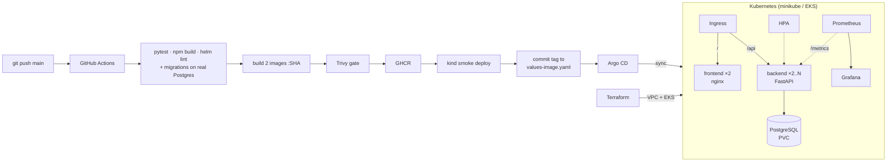

FoundIt – Campus Lost & Found (DevOps Capstone)
===============================================

Name: Anshul Mohanty    Roll No: 24BCS10191    Section: A

**FoundIt** is a campus lost & found board. A student who loses something (an ID card, a bottle, a charger,
a book…) posts a **LOST** report; whoever finds something posts a **FOUND** report. Everyone can browse,
filter and search the board, and an item moves `OPEN → CLAIMED → RETURNED` once it gets back to its owner.

The app is deliberately small. The project is the **DevOps layer** around it:
- tests
- non-root containers
- a CI/CD pipeline with a security gate
- Helm on Kubernetes with an Ingress, autoscaling and probes
- Prometheus/Grafana with custom business metrics
- GitOps delivery through Argo CD
- AWS infrastructure (VPC + EKS) built with Terraform


| Document | What's in it |
|---|---|
| [DESIGN.md](DESIGN.md) | architecture, data model, API, and a **decision log** (why each choice was made) |
| [LEARNING.md](LEARNING.md) | what I learned in each build phase: concepts, real gotchas, viva answers |
| [terraform/README.md](terraform/README.md) | the AWS runbook: apply, deploy, teardown order, cost |
| [troubleshooting/README.md](troubleshooting/README.md) | three break-and-fix Kubernetes labs |

## Architecture



| Layer | Tool |
|---|---|
| Frontend | React 19 + Vite, served by `nginx-unprivileged` |
| Backend | FastAPI, SQLAlchemy 2, Alembic, `prometheus-fastapi-instrumentator` + custom metrics |
| Database | PostgreSQL 16 |
| Tests | pytest (23 tests, temp SQLite) + a CI job that runs the migrations on real Postgres |
| Containers | Docker (multi-stage, non-root), Docker Compose |
| CI/CD | GitHub Actions → GHCR, Trivy, kind; GitOps with Argo CD |
| Kubernetes | Helm chart: Deployments, Services, Ingress, HPA, PDB, PVC, ServiceMonitor |
| Observability | kube-prometheus-stack (Prometheus, Grafana), PrometheusRule alerts |
| Infrastructure | Terraform: AWS VPC + EKS (ap-south-1) |

## API

| Method | Path | |
|---|---|---|
| GET | `/health`, `/ready`, `/metrics`, `/docs` | liveness, readiness (real DB query), Prometheus, Swagger |
| GET | `/api/items?type=&status=&category=&q=` | list, newest first, with filters and search |
| GET | `/api/items/stats` | open lost / open found / claimed / returned / by category |
| GET · PUT · DELETE | `/api/items/{id}` | read, partial update, delete |
| POST | `/api/items` | report an item |
| POST | `/api/items/{id}/resolve` | mark returned (409 if it already is) |

## Run it

**1. Locally with Docker Compose** (PostgreSQL + backend + frontend):

```bash
docker compose up --build
# UI http://localhost:3000 · API http://localhost:8000/docs
```

**2. Tests:**

```bash
cd backend && python -m venv .venv && .venv/Scripts/pip install -r requirements-dev.txt   # Linux/macOS: .venv/bin/pip
.venv/Scripts/python -m pytest -v
```

**3. Kubernetes (minikube) with Helm:**

```bash
minikube start -p devops && minikube -p devops addons enable ingress && minikube -p devops addons enable metrics-server
kubectl apply -f k8s/namespace.yaml
helm upgrade --install foundit helm/foundit -n foundit \
  -f helm/foundit/values-minikube.yaml -f helm/foundit/values-image.yaml --wait
kubectl port-forward -n ingress-nginx svc/ingress-nginx-controller 8081:80
curl -H "Host: foundit.local" localhost:8081/api/items/stats
```

**4. Monitoring:**

```bash
kubectl create namespace monitoring && kubectl apply -f monitoring/foundit-dashboard.yaml
helm upgrade --install kube-prometheus-stack prometheus-community/kube-prometheus-stack \
  -n monitoring -f monitoring/prometheus-values.yaml --wait
kubectl apply -f monitoring/foundit-alerts.yaml
kubectl port-forward -n monitoring svc/kube-prometheus-stack-grafana 3001:80     # admin / foundit-admin
```

**5. GitOps with Argo CD:**

```bash
helm upgrade --install argocd argo/argo-cd -n argocd --create-namespace -f argocd/argocd-values.yaml --wait
kubectl apply -f argocd/foundit-app.yaml
```

**6. AWS EKS:** see [terraform/README.md](terraform/README.md). It covers `plan`/`apply`, deploying with
`values-eks.yaml`, and the teardown order that keeps `terraform destroy` clean.

## The pipeline

[`.github/workflows/ci-cd.yml`](.github/workflows/ci-cd.yml) runs on every push to `main`, on pull requests
and on demand:

| Job | What it does | Fails the build when |
|---|---|---|
| `test` | `pytest -v`, `npm ci && npm run build`, `helm lint` + `helm template` for minikube and EKS | a test fails, the UI doesn't build, the chart is invalid |
| `migrations` | `alembic upgrade → downgrade → upgrade → check` against a PostgreSQL service container | a migration breaks or the models drift from the migrations |
| `build-scan-push` | builds both images tagged with the **commit SHA**, Trivy-scans them, pushes them to GHCR (main only) | Trivy finds a fixable HIGH/CRITICAL CVE |
| `smoke-deploy` | installs the chart with those exact images on a throwaway kind cluster and curls the UI and the API | the pods don't become Ready or the API doesn't answer |
| `gitops-bump` | commits the new SHA to `helm/foundit/values-image.yaml` (`[skip ci]`) | – |

Argo CD watches the repo and syncs the cluster to the new tag. CI never needs cluster credentials.

### Security scanning (M6)

Trivy scans **both images** in every run. It looks at the OS packages of the base images (Debian for
the backend, Alpine for nginx) and at every installed language package (the Python wheels), and checks
them against public CVE databases. The gate is `severity: HIGH,CRITICAL`, `ignore-unfixed: true`,
`exit-code: 1`: the job fails only for serious vulnerabilities that already have a fixed version, so a
failing build always has an action, which is to rebuild or bump the package. A clean result means no
known, fixable HIGH/CRITICAL CVE in what we ship. To prove the gate bites, I scanned an old
`nginx:1.20-alpine`: it shows 30 such CVEs (for example CVE-2022-32207 in curl) and exit code 1
([screenshot](docs/screenshots/11_trivy_local.png)). A second, report-only Trivy step checks the Helm chart,
Dockerfiles and Terraform for misconfigurations. Accepted findings are listed with reasons in
[.trivyignore](.trivyignore).

## Rubric map (GRADING.md)

| Module | Where it is | Evidence |
|---|---|---|
| **M1** Application | [backend/app/](backend/app/), [backend/alembic/versions/](backend/alembic/versions/), [frontend/src/](frontend/src/), [docker-compose.yml](docker-compose.yml) | [API calls](docs/screenshots/02_backend_api.png) · [Swagger](docs/screenshots/03_swagger.png) · [board](docs/screenshots/06_ui_board.png) · [report form](docs/screenshots/07_ui_report_modal.png) · [error state](docs/screenshots/08_ui_backend_down.png) · [migrations](docs/screenshots/04_migrations.png) |
| **M2** Testing | [backend/tests/](backend/tests/), [backend/pytest.ini](backend/pytest.ini), [conftest.py](backend/tests/conftest.py) | [pytest -v, 23 tests](docs/screenshots/05_pytest.png) |
| **M3** Git & GitHub | this repo, [.gitignore](.gitignore) | [commit history](docs/screenshots/28_commit_history.png) |
| **M4** Docker | [backend/Dockerfile](backend/Dockerfile), [frontend/Dockerfile](frontend/Dockerfile) (multi-stage), [docker-compose.yml](docker-compose.yml) | [compose up + psql + non-root `id`](docs/screenshots/09_compose_up.png) · [UI on :3000](docs/screenshots/10_ui_compose.png) |
| **M5** CI/CD | [.github/workflows/ci-cd.yml](.github/workflows/ci-cd.yml) | [jobs + actionlint](docs/screenshots/12_ci_workflow_lint.png) · [green run #1](docs/screenshots/24_ci_pipeline_green.png) · [run #2](docs/screenshots/33_ci_run2_green.png) · [build/scan/push steps](docs/screenshots/25_ci_job_build_scan_push.png) · [GHCR backend :SHA](docs/screenshots/26_ghcr_backend.png) · [GHCR frontend :SHA](docs/screenshots/27_ghcr_frontend.png) |
| **M6** DevSecOps | Trivy steps in the workflow, [.trivyignore](.trivyignore) | [Trivy: clean images, failing old image](docs/screenshots/11_trivy_local.png) · [config scan](docs/screenshots/22_terraform_validate.png) · [Trivy steps in the pipeline](docs/screenshots/25_ci_job_build_scan_push.png) · Trivy tables on the run summary ⏳ (visible when signed in) |
| **M7** Terraform | [terraform/](terraform/), [terraform.tfvars.example](terraform/terraform.tfvars.example) | [fmt + init + validate](docs/screenshots/22_terraform_validate.png) · plan / console / destroy ⏳ Phase 12 |
| **M8** Kubernetes + Helm | [k8s/namespace.yaml](k8s/namespace.yaml), [helm/foundit/](helm/foundit/), [argocd/](argocd/) | [helm list, pods, svc, ingress, hpa](docs/screenshots/13_helm_minikube.png) · [Argo CD app tree](docs/screenshots/29_argocd_synced.png) · [UI through the Ingress](docs/screenshots/14_ui_ingress.png) · [troubleshooting labs](troubleshooting/README.md) |
| **M9** Observability | [monitoring/](monitoring/), [servicemonitor.yaml](helm/foundit/templates/servicemonitor.yaml) | [/metrics](docs/screenshots/23_metrics_endpoint.png) · [targets UP](docs/screenshots/15_prometheus_targets.png) · [Grafana](docs/screenshots/17_grafana_dashboard.png) · [alerts](docs/screenshots/16_prometheus_alerts.png) · [HPA 2→3→2](docs/screenshots/18_hpa_scaling.png) |
| **M10** Docs + demo | this README, [DESIGN.md](DESIGN.md), [LEARNING.md](LEARNING.md) | rehearsed demo: [before v1.0.0](docs/screenshots/30_demo_before_v1.0.0.png) → [CI run #2](docs/screenshots/33_ci_run2_green.png) → [GitOps timeline](docs/screenshots/34_gitops_timeline.png) → [Argo CD synced](docs/screenshots/32_argocd_synced_v1.1.0.png) → [after v1.1.0](docs/screenshots/31_demo_after_v1.1.0.png) |

## Live demo (M10): commit → pipeline → deployment

1. Open the app (`foundit.local`), Argo CD (application `foundit`) and the GitHub Actions tab side by side.
2. Make a visible change. For example, bump `"version"` in `frontend/package.json`; the footer shows it.
3. `git commit -am "…" && git push`.
4. Actions runs: test → migrations → build + Trivy → push `:SHA` to GHCR → kind smoke deploy → bump commit.
5. Argo CD picks up the bump commit (or press **Refresh**), sees `OutOfSync`, syncs, and the pods roll one
   at a time (`maxUnavailable: 0`).
6. Reload the page: the footer shows the new version. `kubectl get deploy -n foundit -o wide` shows the new SHA.

### On this laptop: one heavy add-on at a time

minikube here is capped at 2.73 GiB. The app plus **either** the monitoring stack **or** Argo CD fits;
all three together overload the node (probes start timing out everywhere – see LEARNING.md, Phase 9 and 12).
For the presentation, switch between them:

```bash
# pause monitoring (for the GitOps demo)
kubectl patch prometheus kube-prometheus-stack-prometheus -n monitoring --type merge -p '{"spec":{"replicas":0}}'
kubectl scale deploy -n monitoring --all --replicas=0
# resume monitoring (restores everything from the values file)
helm upgrade kube-prometheus-stack prometheus-community/kube-prometheus-stack -n monitoring -f monitoring/prometheus-values.yaml
```

## Cost and cleanup

The AWS part runs only for a short, planned window. The order is uninstall the app and ingress-nginx →
`terraform destroy` → check the console ([details](terraform/README.md#teardown-in-this-order)). The
local stack is removed with `docker compose down -v` and `minikube delete -p devops`.
