<div align="center">

## 📌 Submission links

**Anshul Mohanty · Roll No 10191 · Batch 2028 · Section A**

[](https://www.youtube.com/watch?v=J7fwITHZJPA)
[](https://drive.google.com/file/d/1VCKWqnQeH0bZYMiNE77b_okiriHwINRR/view?usp=drive_link)
[](https://drive.google.com/file/d/1NHW3pUjpn-OWdpA-C0vQQ_bd2yTNoRxX/view?usp=drive_link)

<a href="https://www.youtube.com/watch?v=J7fwITHZJPA"></a>

<sub>▶ Click the thumbnail to watch the 2:54 demo on YouTube</sub>

| | Link | What it is |
|:-:|---|---|
| 🎬 | **[Demo video — YouTube](https://www.youtube.com/watch?v=J7fwITHZJPA)** | 2:54 narrated walkthrough: the app, the architecture, a **live commit → CI/CD → Argo CD → production** run, monitoring, problems I solved, AWS EKS |
| 📁 | **[Demo video — Google Drive](https://drive.google.com/file/d/1VCKWqnQeH0bZYMiNE77b_okiriHwINRR/view?usp=drive_link)** | the same video as a downloadable file |
| 📊 | **[Presentation — PDF](https://drive.google.com/file/d/1NHW3pUjpn-OWdpA-C0vQQ_bd2yTNoRxX/view?usp=drive_link)** | 14-slide deck: architecture, pipeline, DevSecOps, Kubernetes, GitOps, observability, Terraform/AWS, results |
| 💻 | **[This repository](https://github.com/AnshulMohanty/DevOps-CapStone-Project)** | all code, the 5-job pipeline, Helm chart, Terraform, 54 evidence screenshots and docs |

</div>

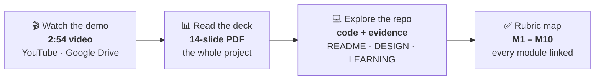

---

<div align="center">

# 🔎 FoundIt — Campus Lost & Found

**A small full-stack app, shipped the way production software is shipped:**
**tested · containerised · scanned · deployed by GitOps · observed · autoscaled · running on AWS EKS built with Terraform.**

[](https://github.com/AnshulMohanty/DevOps-CapStone-Project/actions/workflows/ci-cd.yml)


**Anshul Mohanty** · Roll No 24BCS10191 · Section A · DevOps Session 21 — Final Capstone

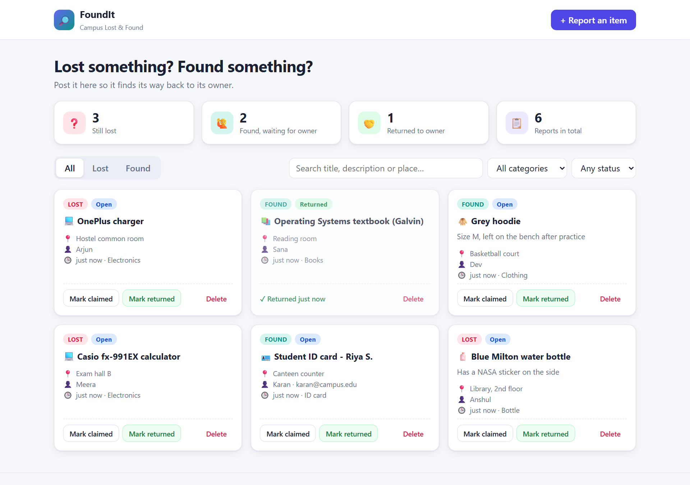

</div>

---

## ✨ At a glance

| | |
|---|---|
| 🧪 **23** automated tests + migrations tested on real PostgreSQL in CI | 🐳 **2** non-root images (90 MB frontend), multi-stage build |
| 🔁 **5**-job pipeline on every push: test → migrate → build/scan/push → smoke-deploy → GitOps bump | 🛡️ **0** fixable HIGH/CRITICAL CVEs (Trivy gate), **0** IaC misconfigurations |
| ☸️ Helm chart with Ingress, HPA, PDB, PVC, probes, read-only root filesystems | 🔄 **Argo CD** deploys every commit — CI never touches the cluster |
| 📈 Prometheus + Grafana with **custom business metrics** and 4 alert rules | ☁️ **62** AWS resources (VPC + EKS) created **and destroyed** with Terraform |

📘 **[DESIGN.md](DESIGN.md)** — architecture and a **decision log of 63 decisions** (what and *why*)  
📗 **[LEARNING.md](LEARNING.md)** — what I learned in each of the 12 build phases, including every real problem I hit

---

## 📑 Contents

1. [The app](#app)
2. [Architecture](#architecture)
3. [Delivery pipeline: CI/CD + GitOps](#pipeline)
4. [Repository layout](#layout)
5. [Run it](#run)
6. [Security: DevSecOps with Trivy (M6)](#security)
7. [Kubernetes & Helm](#kubernetes)
8. [Observability & autoscaling](#observability)
9. [Live demo: commit → pipeline → deployment](#demo)
10. [AWS: Terraform → EKS → destroy](#aws)
11. [Troubleshooting labs](#labs)
12. [Rubric map (M1–M10)](#rubric)
13. [Evidence gallery](#gallery)
14. [Lessons learned](#lessons)

---

<a id="app"></a>

## 🧩 The app

Students report items they **lost** or **found** on campus; everyone can browse, filter and search the board,
and an item travels from *open* to *returned*.

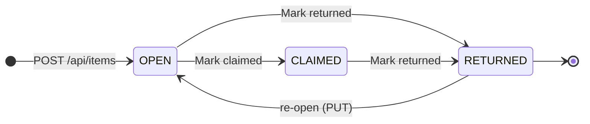

| Feature | Details |
|---|---|
| Report an item | LOST / FOUND, category (electronics, ID card, books, bottle, clothing, other), place, reporter, contact |
| Browse | All / Lost / Found tabs, category + status filters, search over title, description and place |
| Act | Mark claimed · Mark returned (sets `resolved_at`, 409 if already returned) · Delete |
| Dashboard | Still lost · Found & waiting · Returned · Total |
| Resilient UI | loading skeletons, empty state, clear "API unreachable" banner with retry |

**API** (FastAPI, Swagger at `/docs`):

| Method | Path | Purpose |
|---|---|---|
| GET | `/health` · `/ready` · `/metrics` | liveness · readiness (real DB query) · Prometheus |
| GET | `/api/items?type=&status=&category=&q=` | list with filters and search |
| GET | `/api/items/stats` | counters for the dashboard |
| GET · PUT · DELETE | `/api/items/{id}` | read · partial update · delete |
| POST | `/api/items` · `/api/items/{id}/resolve` | report · mark returned |

The schema is versioned with **Alembic** (`0001_create_items` → `0002_add_resolved_at`) and the container runs
`alembic upgrade head` before it starts serving.

---

<a id="architecture"></a>

## 🏗️ Architecture

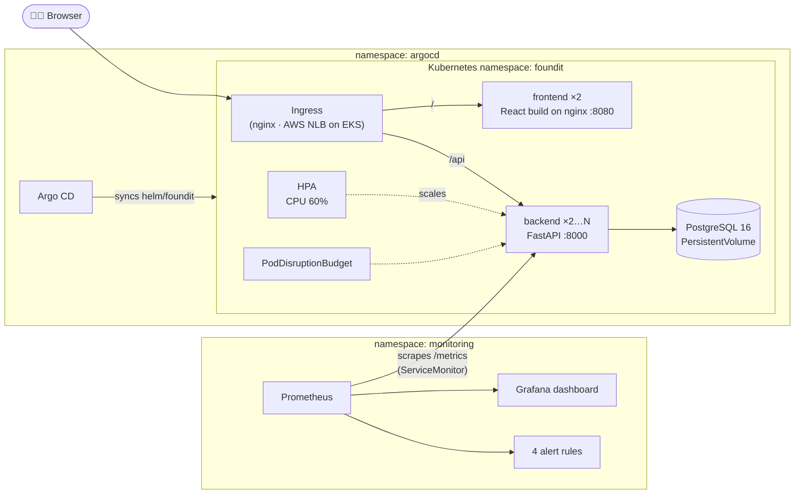

**How a request flows:**

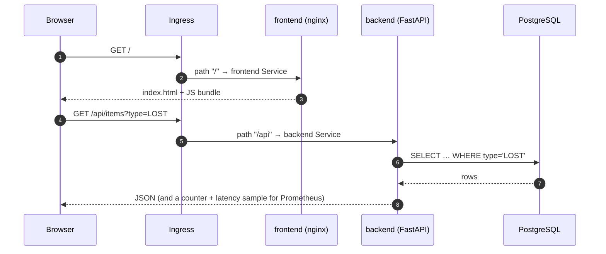

The browser only ever calls relative `/api/…` URLs, so the **same images** work behind Vite (dev), nginx
(Docker Compose), the minikube Ingress and an AWS load balancer.

---

<a id="pipeline"></a>

## 🚀 Delivery pipeline: CI/CD + GitOps

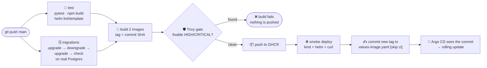

| Job | What it proves |
|---|---|
| `test` | the code works (23 tests), the UI builds, the chart renders for every environment |
| `migrations` | the real migration scripts work on a real PostgreSQL (unit tests use SQLite) |
| `build-scan-push` | images build, contain no fixable HIGH/CRITICAL CVE, and are published as `:<sha>` |
| `smoke-deploy` | those exact images start and answer when installed by the chart |
| `gitops-bump` | records *what should run* in git — Argo CD does the deploying |

**Why GitOps?** CI needs no cluster credentials, every deployment is a reviewable commit, a rollback is
`git revert`, and Argo CD reverts manual drift (`selfHeal`). The deploy commits are authored by the developer
who pushed — `deploy: foundit <sha> [skip ci]`.

<p align="center">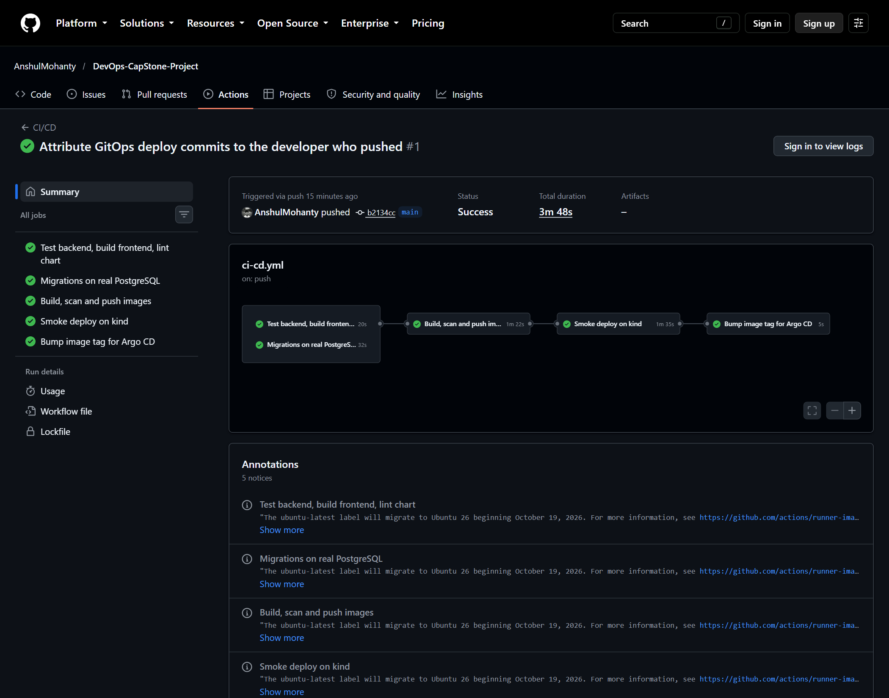</p>

---

<a id="layout"></a>

## 🗂️ Repository layout

```text
.
├── backend/                 FastAPI app, Alembic migrations, 23 pytest tests, non-root Dockerfile
├── frontend/                React + Vite UI, nginx template, multi-stage Dockerfile
├── docker-compose.yml       postgres → backend → frontend with healthchecks
├── .github/workflows/       ci-cd.yml — the 5-job pipeline
├── k8s/                     namespace
├── helm/foundit/            the chart + values for minikube, EKS and the CI-owned image tags
├── argocd/                  Argo CD Application + lean install values
├── monitoring/              kube-prometheus-stack values, Grafana dashboard, alert rules
├── terraform/               AWS VPC + EKS (runbook in terraform/README.md)
├── troubleshooting/         3 deliberately broken manifests + lab guide
├── scripts/load-test.sh     in-cluster load generator for the HPA
├── docs/screenshots/        54 evidence screenshots
├── DESIGN.md                architecture + decision log
└── LEARNING.md              phase-by-phase learning notes
```

---

<a id="run"></a>

## ▶️ Run it

<details open>
<summary><b>1 · Docker Compose — the whole stack with one command</b></summary>

```bash
docker compose up --build
# UI   → http://localhost:3000
# API  → http://localhost:8000/docs
```
</details>

<details>
<summary><b>2 · Tests</b></summary>

```bash
cd backend
python -m venv .venv && .venv/Scripts/pip install -r requirements-dev.txt     # Linux/macOS: .venv/bin/pip
.venv/Scripts/python -m pytest -v
```
</details>

<details>
<summary><b>3 · Kubernetes (minikube) with Helm</b></summary>

```bash
minikube start -p devops
minikube -p devops addons enable ingress && minikube -p devops addons enable metrics-server
kubectl apply -f k8s/namespace.yaml
helm upgrade --install foundit helm/foundit -n foundit \
  -f helm/foundit/values-minikube.yaml -f helm/foundit/values-image.yaml --wait
kubectl port-forward -n ingress-nginx svc/ingress-nginx-controller 8081:80
curl -H "Host: foundit.local" localhost:8081/api/items/stats
```
</details>

<details>
<summary><b>4 · Monitoring (Prometheus + Grafana)</b></summary>

```bash
kubectl create namespace monitoring && kubectl apply -f monitoring/foundit-dashboard.yaml
helm upgrade --install kube-prometheus-stack prometheus-community/kube-prometheus-stack \
  -n monitoring -f monitoring/prometheus-values.yaml --wait
kubectl apply -f monitoring/foundit-alerts.yaml
kubectl port-forward -n monitoring svc/kube-prometheus-stack-grafana 3001:80      # admin / foundit-admin
```
</details>

<details>
<summary><b>5 · GitOps (Argo CD)</b></summary>

```bash
helm upgrade --install argocd argo/argo-cd -n argocd --create-namespace -f argocd/argocd-values.yaml --wait
kubectl apply -f argocd/foundit-app.yaml
```

> On this laptop minikube is capped at 2.73 GiB: the app plus **either** monitoring **or** Argo CD fits.
> Pause monitoring for the GitOps demo with
> `kubectl patch prometheus kube-prometheus-stack-prometheus -n monitoring --type merge -p '{"spec":{"replicas":0}}' && kubectl scale deploy -n monitoring --all --replicas=0`
> and bring it back with `helm upgrade kube-prometheus-stack prometheus-community/kube-prometheus-stack -n monitoring -f monitoring/prometheus-values.yaml --force-conflicts`
> (Helm 4 applies server-side, so it must take back the fields that `kubectl patch`/`scale` changed — the same goes for
> pausing Argo CD with `kubectl scale` and restoring it with `helm upgrade argocd … --force-conflicts`).
</details>

<details>
<summary><b>6 · AWS EKS</b></summary>

See [terraform/README.md](terraform/README.md) and the [AWS section](#aws) below.
</details>

---

<a id="security"></a>

## 🛡️ Security: DevSecOps with Trivy (M6)

**What Trivy scans.** In every pipeline run Trivy scans **both images**: the operating-system packages of the
base images (Debian 13 for the backend, Alpine 3.24 for nginx) and every installed language package (all the
Python wheels in the backend), and compares them with public vulnerability databases.

**What makes the build fail.** `severity: HIGH,CRITICAL`, `ignore-unfixed: true`, `exit-code: 1` — the job fails
only for serious vulnerabilities that **already have a fixed version**, so a red build always has an action
(rebuild or bump the package). A failed scan means the image is **never pushed**, so it can never be deployed.

**What the result means.** All targets report **0** — no known, fixable HIGH/CRITICAL CVE in what we ship.
To prove the gate actually bites, I scanned an old `nginx:1.20-alpine`: **30** such CVEs (e.g.
**CVE-2022-32207**, a critical flaw in curl where files could be saved with unsafe permissions; fixed in a
newer curl) and exit code 1. A second, report-only Trivy step scans the Helm chart, Dockerfiles and Terraform
for misconfigurations — **0** findings, with the two accepted risks documented in [.trivyignore](.trivyignore).

| Trivy in the pipeline — backend | Trivy in the pipeline — frontend + config |
|---|---|
| 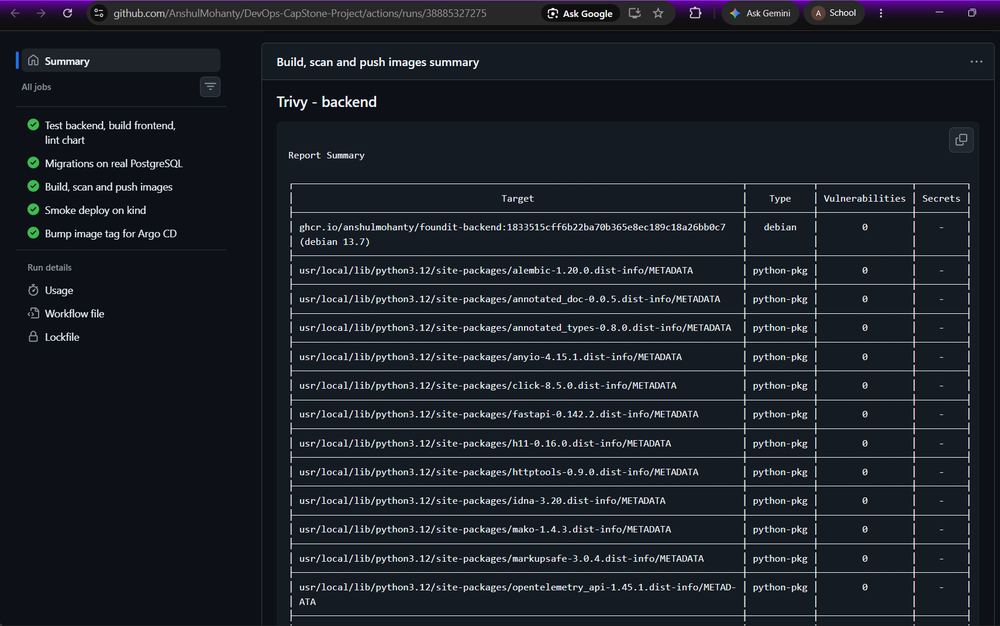 | 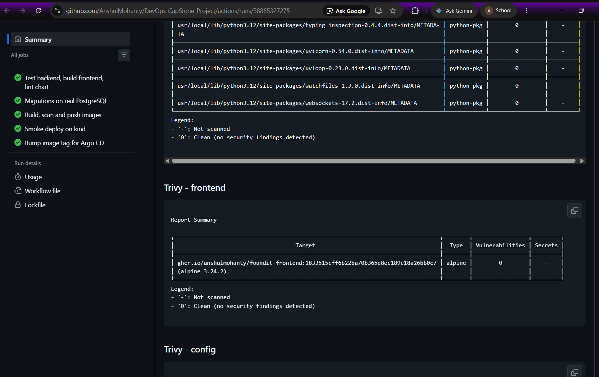<br>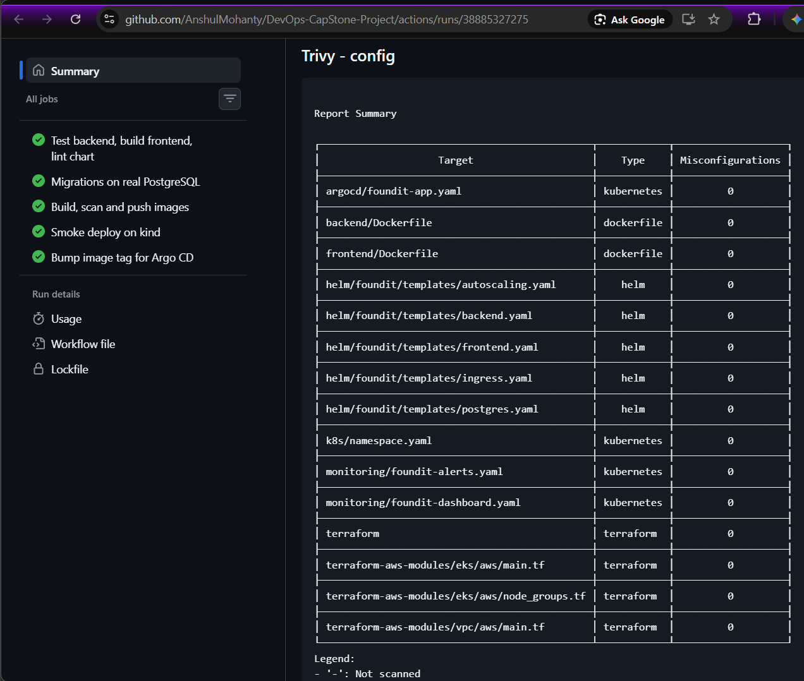 |

**Hardening, in short:** non-root containers (uid 10001 / 101 / 70) · read-only root filesystems ·
`allowPrivilegeEscalation: false` + all capabilities dropped · seccomp `RuntimeDefault` · images pinned to
commit SHAs · no secrets in git (gitleaks-clean history, `.tfvars`/state ignored) · the EKS API reachable only
from one IP · AWS permissions for pods through **EKS Pod Identity** (per-pod IAM role).

---

<a id="kubernetes"></a>

## ☸️ Kubernetes & Helm

| Object | Why it's there |
|---|---|
| **Deployments** (backend, frontend, postgres) | `maxUnavailable: 0` rolling updates; backend replicas owned by the HPA |
| **ClusterIP Services** | stable names for pods; selected by `app.kubernetes.io/*` labels |
| **Ingress** | `/api` → backend, `/` → frontend; host `foundit.local` on minikube, any host on EKS |
| **Secret** | database credentials, injected as env vars; a checksum annotation rolls pods when it changes |
| **PersistentVolumeClaim** | Postgres data; `helm.sh/resource-policy: keep` so uninstalling never deletes the database |
| **HPA** (2→3 minikube, 2→6 EKS) + **PDB** | scale on CPU; never fewer than 1 backend during node drains |
| **ServiceMonitor** | Prometheus discovers the backend's `/metrics` — rendered only if the CRD exists |
| **Probes** | startup + liveness on `/health`, readiness on `/ready` (real DB query) |

> **Liveness vs readiness, in one sentence:** a database outage makes pods *not ready* (taken out of the
> Service, no restart storm) instead of *not alive* — demonstrated in [lab 3](troubleshooting/README.md).

<p align="center">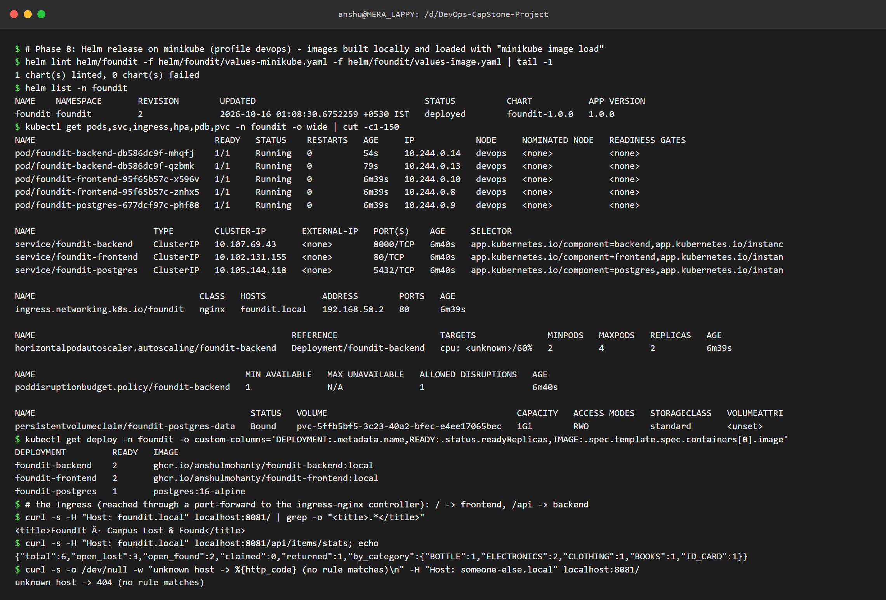</p>

---

<a id="observability"></a>

## 📈 Observability & autoscaling

Prometheus scrapes every backend pod; Grafana shows **service health** (targets up, requests/s, p95 latency,
5xx ratio, pods, CPU) and **business metrics** (`foundit_items_reported_total`, `foundit_items_resolved_total`,
`foundit_items_open`).

<p align="center">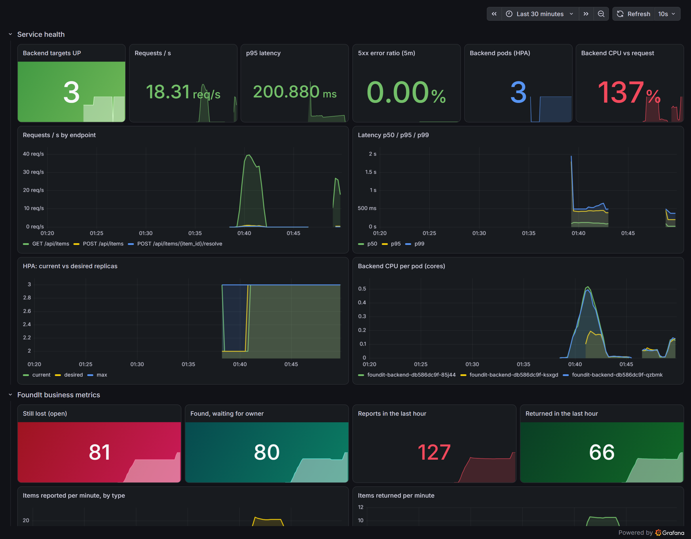</p>

| Alert | Fires when |
|---|---|
| `FoundItBackendDown` | no backend target scraped for 1 min |
| `FoundItHighErrorRate` | > 5 % of requests return 5xx for 5 min |
| `FoundItSlowRequests` | p95 latency > 1 s for 10 min |
| `FoundItHPAAtMaximum` | the autoscaler has been at its maximum for 10 min — scaling has run out of room |

**Autoscaling under load** (in-cluster load test): CPU 246 % of request → **2 → 3 pods** in ~10 s, back to
**2** after the 120 s stabilisation window. [Prometheus targets](docs/screenshots/15_prometheus_targets.png) ·
[alert rules](docs/screenshots/16_prometheus_alerts.png) · [HPA timeline](docs/screenshots/18_hpa_scaling.png) ·
[`/metrics`](docs/screenshots/23_metrics_endpoint.png)

---

<a id="demo"></a>

## 🎬 Live demo: commit → pipeline → deployment

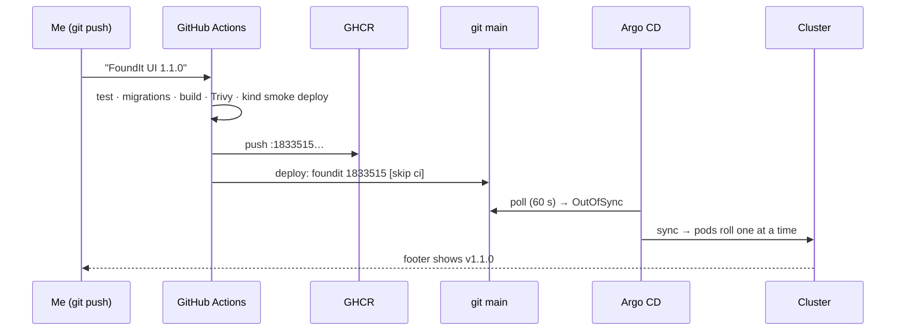

| Before | After |
|---|---|
| 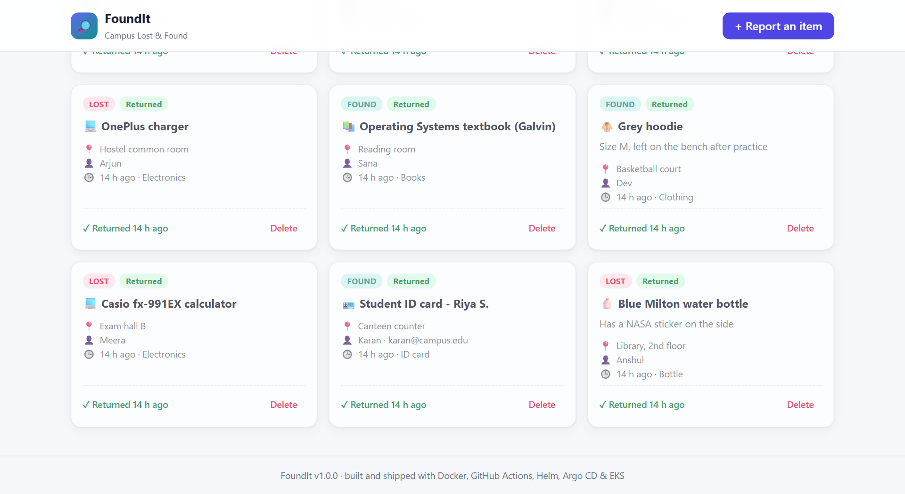 | 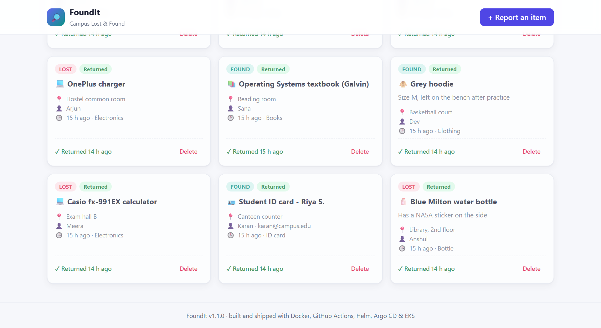 |

[Argo CD synced to the deploy commit](docs/screenshots/32_argocd_synced_v1.1.0.png) ·
[the recorded timeline](docs/screenshots/34_gitops_timeline.png) ·
[pipeline run #2](docs/screenshots/49_ci_run_summary.png)

📺 **Watch it happen:** [the demo video](https://www.youtube.com/watch?v=J7fwITHZJPA) records a real run (`FoundIt UI 1.2.0`, pipeline run #4, 3 m 42 s).

**To repeat it live:** change something visible (e.g. `"version"` in `frontend/package.json`) → commit → push →
watch Actions → watch Argo CD go *OutOfSync → Synced* → reload the page.

---

<a id="aws"></a>

## ☁️ AWS: Terraform → EKS → destroy

### Why the AWS part ran on a different account

My own AWS account was still **under verification** when it was time to deploy — AWS can take 2–3 days to
activate a new account. To keep to the schedule I ran the AWS part on a **friend's AWS account, with their
permission**, through a dedicated IAM user whose keys lived only in `~/.aws` on my laptop (never in this repo).
Account identifiers in the AWS screenshots are **blurred** because the account is not mine.

That account belongs to an **AWS Organization** whose guardrails (Service Control Policies) shaped the
deployment. Each one showed up as a failure, was diagnosed from the real error, and the code was adapted:

| Guardrail | How it showed up | What I changed |
|---|---|---|
| Only **ap-southeast-2 (Sydney)** is allowed | `explicit deny in a service control policy` for EC2/EKS in all 8 regions I tested | `aws_region = "ap-southeast-2"` |
| The account is on the **AWS Free plan** — only Free-Tier-eligible instance types launch | node group stuck in `CREATING`; the Auto Scaling activity said *"instance type is not eligible for Free Tier"* | nodes are **`c7i-flex.large`** (2 vCPU / 4 GiB, eligible) instead of `t3.medium` |
| `iam:CreateOpenIDConnectProvider` is denied | `terraform apply` → 403 on the OIDC provider (needed for IRSA) | `enable_irsa = false`; the EBS CSI driver gets its IAM role through **EKS Pod Identity** (no OIDC provider) |

### What Terraform builds

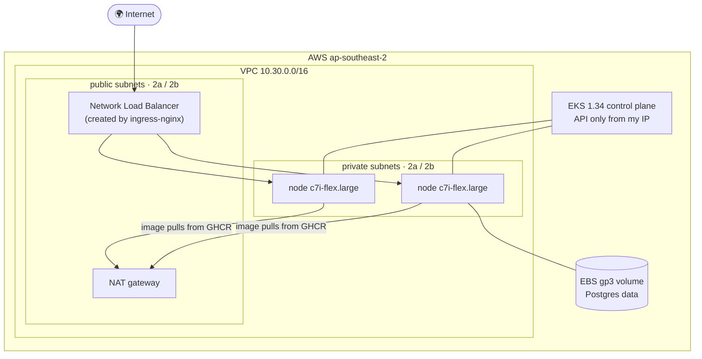

Modules: `terraform-aws-modules/vpc` + `terraform-aws-modules/eks`, addons **vpc-cni, coredns, kube-proxy,
eks-pod-identity-agent, aws-ebs-csi-driver (gp3 default StorageClass), metrics-server**. Every resource is
tagged `Project=foundit`.

### What happened

| Step | Result |
|---|---|
| `terraform plan` | **62 to add**, 0 to change, 0 to destroy |
| `terraform apply` | VPC, NAT, IAM, EKS control plane (8 m 36 s) → fixed the two guardrail failures → node group Active in 1 m 15 s, Pod Identity, 6 addons |
| deploy | `ingress-nginx` → **AWS NLB**; FoundIt from the CI-built GHCR images with `values-eks.yaml`; Postgres on a **gp3 EBS** volume; backend pods spread over both zones |
| teardown | app + ingress uninstalled first (Kubernetes deletes the NLB and the EBS volume) → `terraform destroy` → **62 destroyed** |
| verification | 0 VPCs, NAT gateways, Elastic IPs, load balancers, nodes, volumes, IAM roles or log groups left; KMS key pending deletion (no charge) |
| cost | ≈ $0.42/hour for ~1.5 hours — about **$1** |

| | |
|---|---|
| 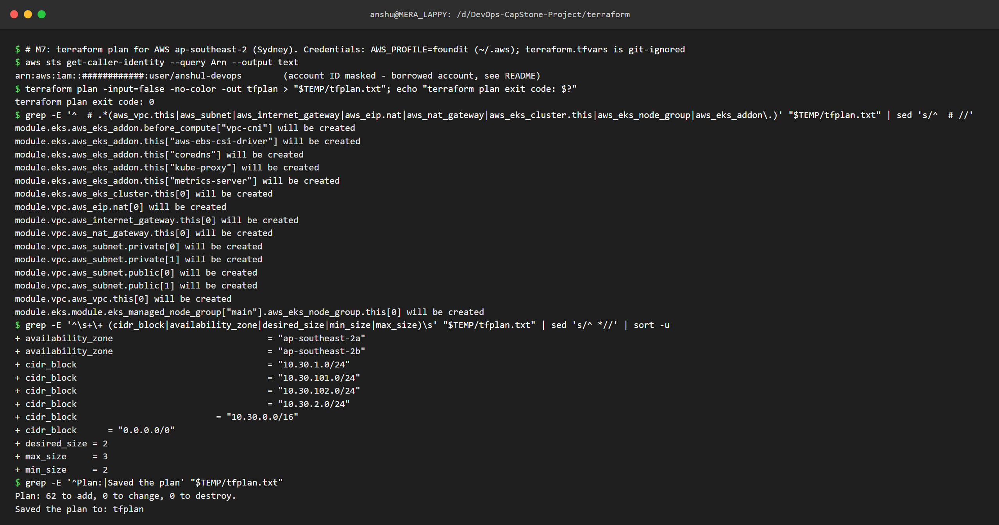<br>`terraform plan` | 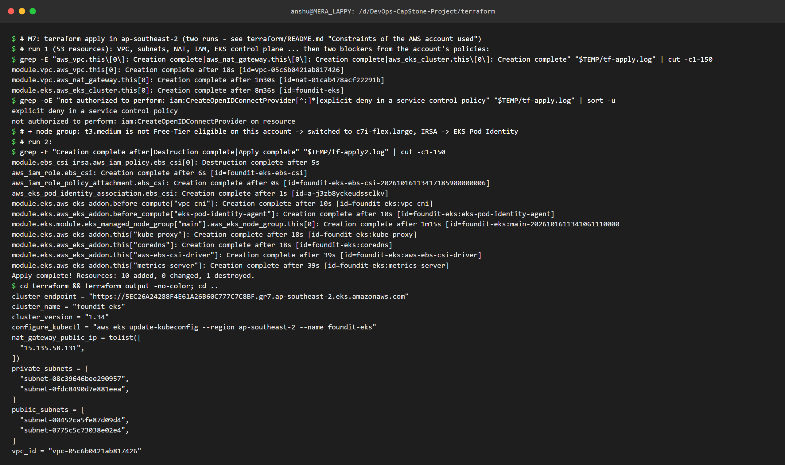<br>`terraform apply` |
| 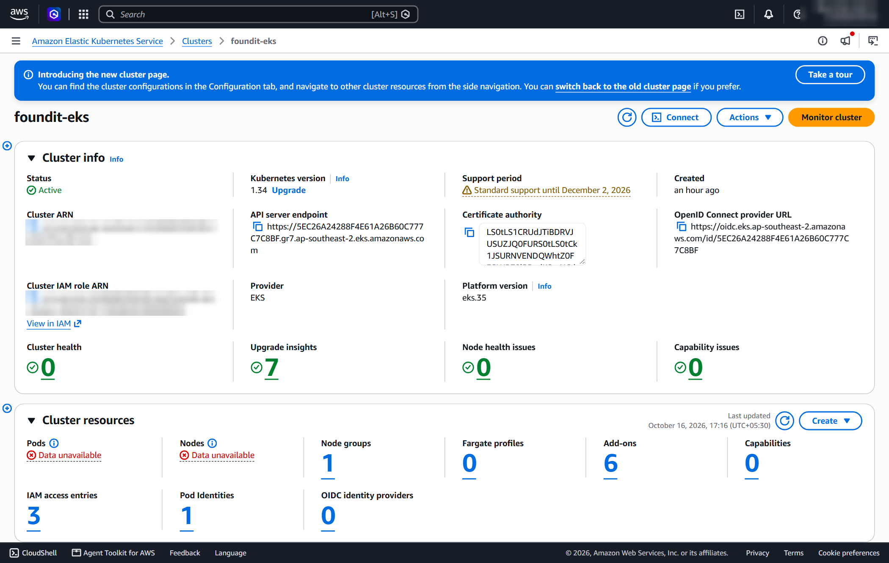<br>EKS cluster *Active* | 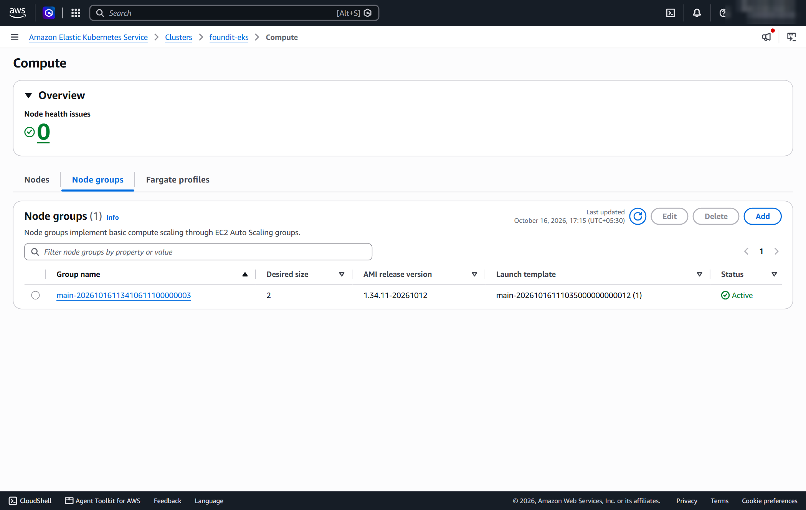<br>managed node group |
| 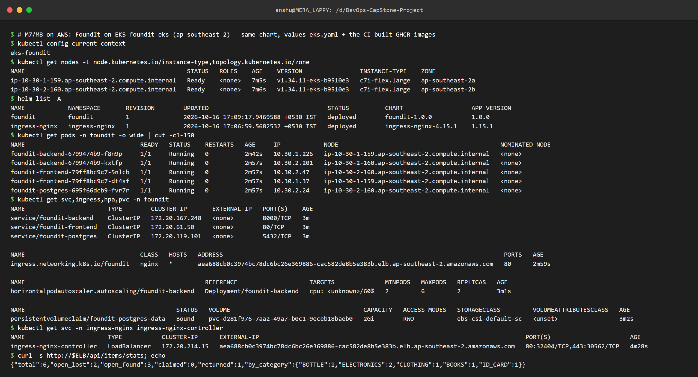<br>pods, services, Ingress on EKS | 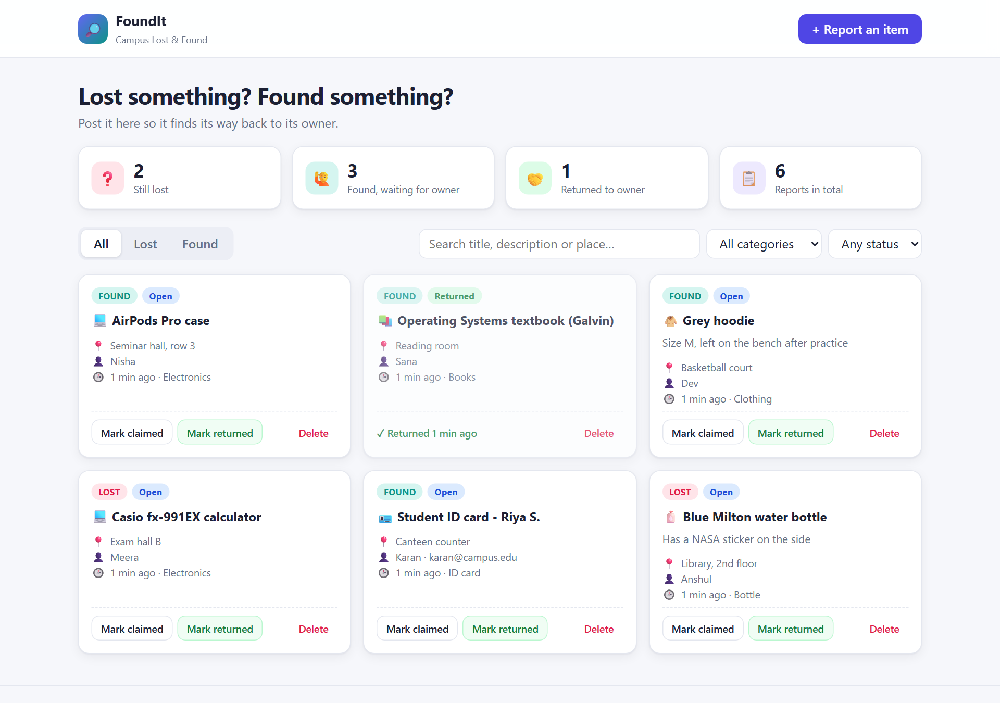<br>FoundIt through the AWS load balancer |
| 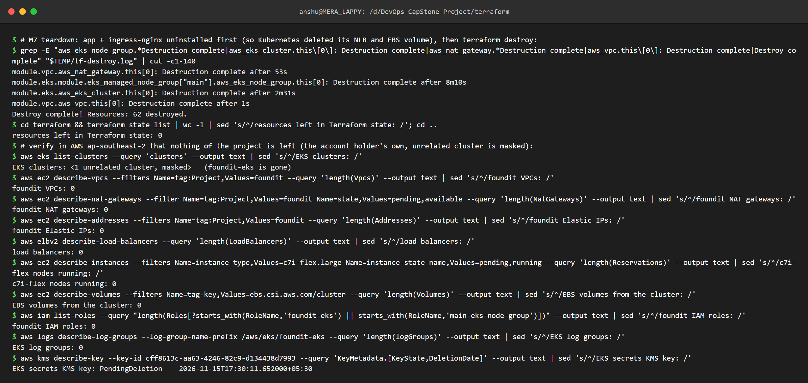<br>`terraform destroy` + checks | 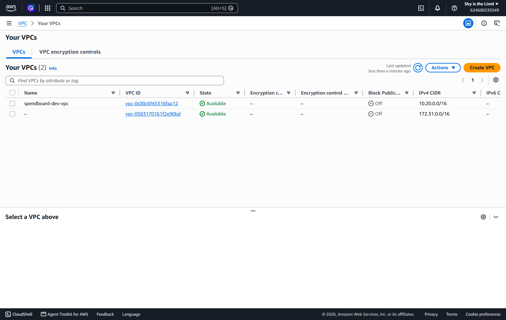<br>console afterwards: no FoundIt VPC |

More: [VPC](docs/screenshots/41_aws_vpc.png) · [subnets](docs/screenshots/42_aws_subnets.png) ·
[NAT gateway](docs/screenshots/43_aws_nat_gateway.png) · [EC2 nodes](docs/screenshots/44_aws_ec2_instances.png) ·
[load balancer](docs/screenshots/45_aws_load_balancer.png) · [EKS after destroy](docs/screenshots/48_aws_eks_after_destroy.png) ·
full runbook in [terraform/README.md](terraform/README.md).

---

<a id="labs"></a>

## 🧯 Troubleshooting labs

| Lab | Symptom | First command | Root cause |
|---|---|---|---|
| [broken-image](troubleshooting/broken-image.yaml) | `ImagePullBackOff` | `kubectl describe pod` | tag `v1.0.O` (letter O) never pushed |
| [broken-service](troubleshooting/broken-service.yaml) | pods fine, requests fail | `kubectl get endpointslices` | Service selector doesn't match pod labels |
| [broken-readiness](troubleshooting/broken-readiness.yaml) | `0/1 Running`, 0 restarts | `kubectl describe pod` + `logs` | wrong DB password → readiness 503, kept out of the Service |

Guide and method: [troubleshooting/README.md](troubleshooting/README.md) ·
screenshots [1](docs/screenshots/19_lab_broken_image.png) · [2](docs/screenshots/20_lab_broken_service.png) · [3](docs/screenshots/21_lab_broken_readiness.png)

---

<a id="rubric"></a>

## ✅ Rubric map (M1–M10)

| Module | Where it is | Evidence |
|---|---|---|
| **M1** Application (10) | [backend/app/](backend/app/), [alembic/versions/](backend/alembic/versions/), [frontend/src/](frontend/src/), [docker-compose.yml](docker-compose.yml) | [API](docs/screenshots/02_backend_api.png) · [Swagger](docs/screenshots/03_swagger.png) · [migrations](docs/screenshots/04_migrations.png) · [board](docs/screenshots/06_ui_board.png) · [report form](docs/screenshots/07_ui_report_modal.png) · [error state](docs/screenshots/08_ui_backend_down.png) |
| **M2** Testing (10) | [backend/tests/](backend/tests/), [pytest.ini](backend/pytest.ini), [conftest.py](backend/tests/conftest.py) | [pytest -v — 23 passed](docs/screenshots/05_pytest.png) |
| **M3** Git (5) | public repo, [.gitignore](.gitignore), meaningful commits | [commit history](docs/screenshots/28_commit_history.png) |
| **M4** Docker (10) | [backend/Dockerfile](backend/Dockerfile), [frontend/Dockerfile](frontend/Dockerfile), [docker-compose.yml](docker-compose.yml) | [`docker compose up --build`](docs/screenshots/55_compose_up_build.png) · [psql + non-root `id`](docs/screenshots/09_compose_up.png) · [UI on :3000](docs/screenshots/10_ui_compose.png) |
| **M5** CI/CD (15) | [.github/workflows/ci-cd.yml](.github/workflows/ci-cd.yml) | [run #1](docs/screenshots/24_ci_pipeline_green.png) · [run #2](docs/screenshots/33_ci_run2_green.png) · [run #2 summary](docs/screenshots/49_ci_run_summary.png) · [job steps](docs/screenshots/25_ci_job_build_scan_push.png) · [GHCR backend :SHA](docs/screenshots/26_ghcr_backend.png) · [GHCR frontend :SHA](docs/screenshots/27_ghcr_frontend.png) · [pushed tags + bump](docs/screenshots/54_ci_pushed_images_and_bump.png) |
| **M6** DevSecOps (5) | Trivy steps in the workflow, [.trivyignore](.trivyignore), [explanation](#security) | [backend](docs/screenshots/50_ci_trivy_backend.png) · [backend packages](docs/screenshots/51_ci_trivy_backend_packages.png) · [frontend](docs/screenshots/52_ci_trivy_frontend.png) · [config](docs/screenshots/53_ci_trivy_config.png) · [gate failing on an old image](docs/screenshots/11_trivy_local.png) |
| **M7** Terraform (15) | [terraform/](terraform/), [terraform.tfvars.example](terraform/terraform.tfvars.example) | [validate](docs/screenshots/22_terraform_validate.png) · [plan](docs/screenshots/35_terraform_plan.png) · [apply](docs/screenshots/36_terraform_apply.png) · [EKS](docs/screenshots/39_aws_eks_cluster.png) · [node group](docs/screenshots/40_aws_eks_nodegroups.png) · [VPC](docs/screenshots/41_aws_vpc.png) · [destroy](docs/screenshots/46_terraform_destroy.png) · [after](docs/screenshots/47_aws_after_destroy.png) |
| **M8** Kubernetes + Helm (15) | [k8s/](k8s/), [helm/foundit/](helm/foundit/), [argocd/](argocd/) | [pods · svc · helm list · ingress](docs/screenshots/13_helm_minikube.png) · [UI via Ingress](docs/screenshots/14_ui_ingress.png) · [on EKS](docs/screenshots/37_eks_kubectl.png) · [via AWS NLB](docs/screenshots/38_eks_app_via_nlb.png) · [Argo CD](docs/screenshots/29_argocd_synced.png) |
| **M9** Observability (10) | [monitoring/](monitoring/), [servicemonitor.yaml](helm/foundit/templates/servicemonitor.yaml) | [/metrics](docs/screenshots/23_metrics_endpoint.png) · [targets UP](docs/screenshots/15_prometheus_targets.png) · [Grafana](docs/screenshots/17_grafana_dashboard.png) · [alerts](docs/screenshots/16_prometheus_alerts.png) · [HPA](docs/screenshots/18_hpa_scaling.png) |
| **M10** Docs + demo (5) | this README, [DESIGN.md](DESIGN.md), [LEARNING.md](LEARNING.md), [demo video](https://www.youtube.com/watch?v=J7fwITHZJPA), [presentation](https://drive.google.com/file/d/1NHW3pUjpn-OWdpA-C0vQQ_bd2yTNoRxX/view?usp=drive_link) | rehearsed demo: [before](docs/screenshots/30_demo_before_v1.0.0.png) → [run](docs/screenshots/49_ci_run_summary.png) → [timeline](docs/screenshots/34_gitops_timeline.png) → [synced](docs/screenshots/32_argocd_synced_v1.1.0.png) → [after](docs/screenshots/31_demo_after_v1.1.0.png) |

<details>
<summary><b>Submission checklist (GRADING.md) — all ✅</b></summary>

| | Item |
|---|---|
| ✅ | GitHub repository public, 25+ meaningful commits |
| ✅ | App runs via `docker compose up --build`; 7 REST endpoints (GET/POST/PUT/DELETE); 2 Alembic migrations |
| ✅ | pytest passes — 23 tests on a temporary SQLite DB, never the real database |
| ✅ | backend Dockerfile builds; frontend Dockerfile multi-stage (Node → nginx); non-root `USER` in both |
| ✅ | workflow runs on push to `main`; pytest + frontend build in the pipeline; images pushed to GHCR with commit-SHA tags |
| ✅ | Trivy scans both images and fails on fixable HIGH/CRITICAL; gitleaks finds no secrets in the history |
| ✅ | `terraform plan` output · VPC + EKS in the AWS console · `terraform destroy` output |
| ✅ | `kubectl get pods` (all Running) · `kubectl get svc` · `helm list` · app reachable through the Ingress |
| ✅ | `/metrics` · Prometheus target UP · populated Grafana dashboard |
| ✅ | README present · live demo rehearsed end to end |
</details>

---

<a id="gallery"></a>

## 🖼️ Evidence gallery

| | | |
|---|---|---|
| 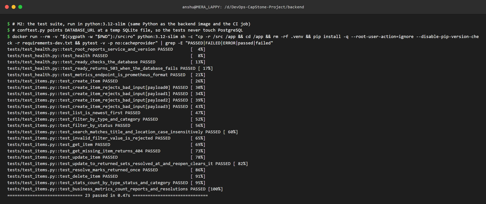<br>pytest | 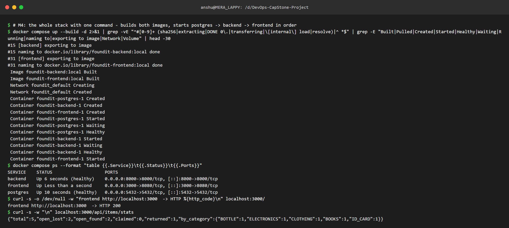<br>compose up --build | 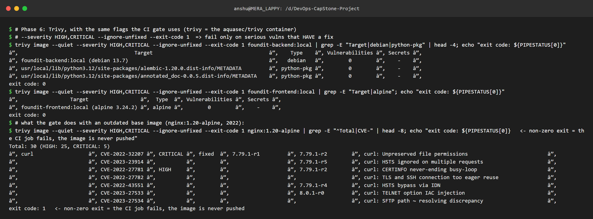<br>Trivy gate |
| <br>pipeline | 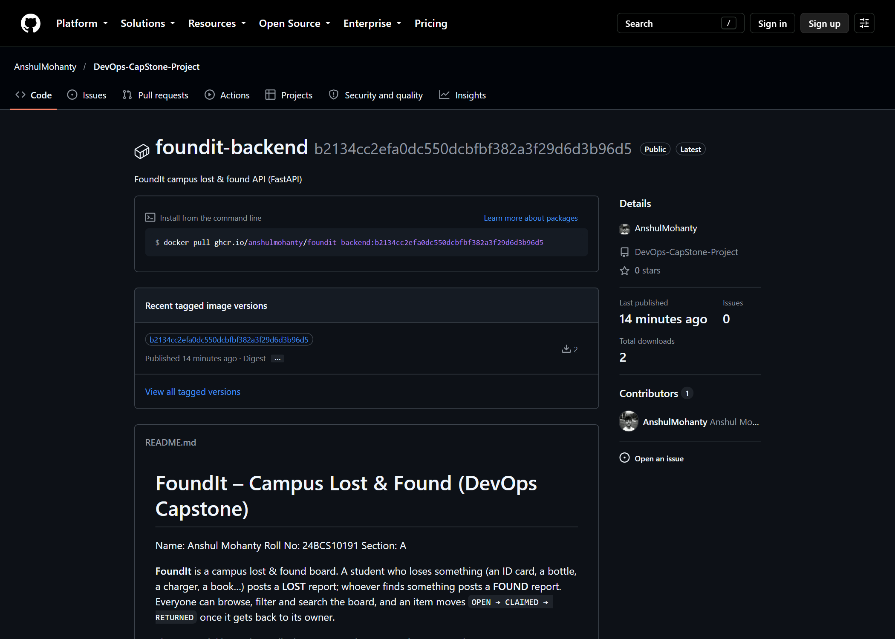<br>GHCR | 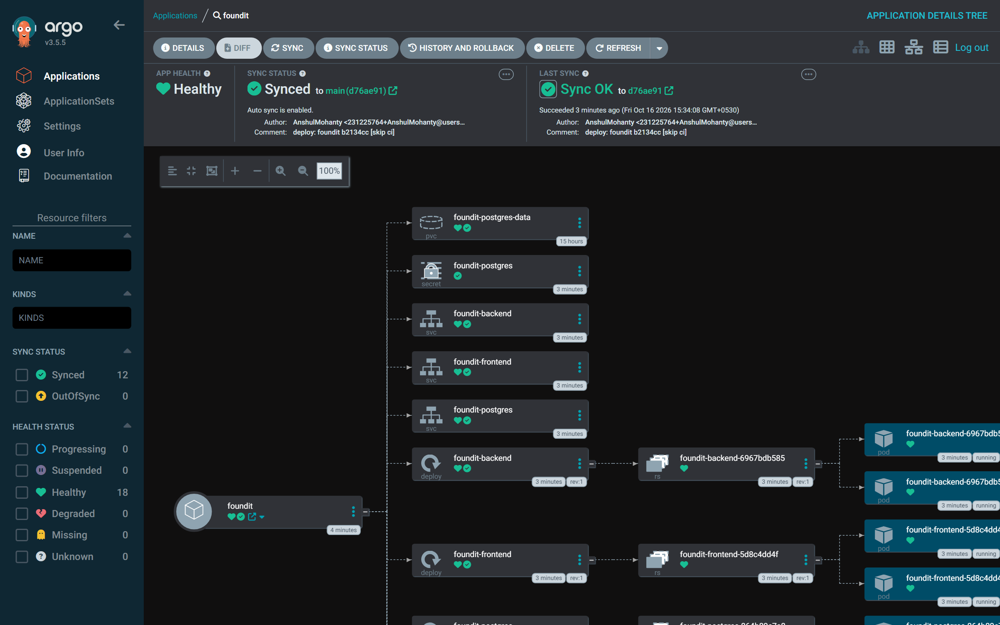<br>Argo CD |
| 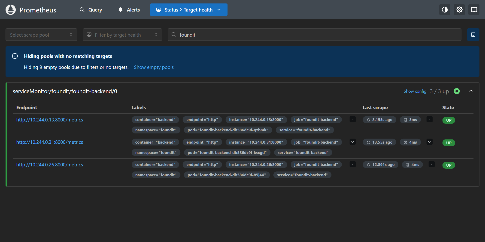<br>Prometheus | 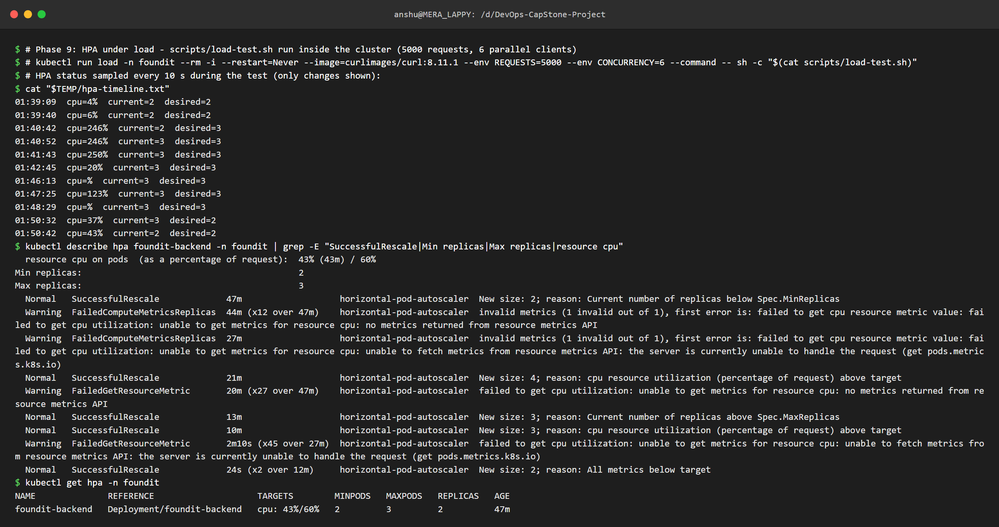<br>HPA | 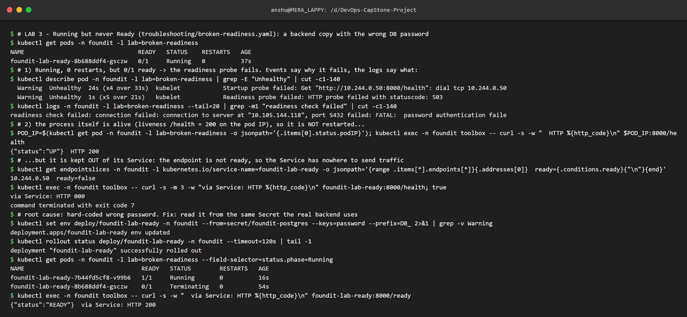<br>readiness lab |
| 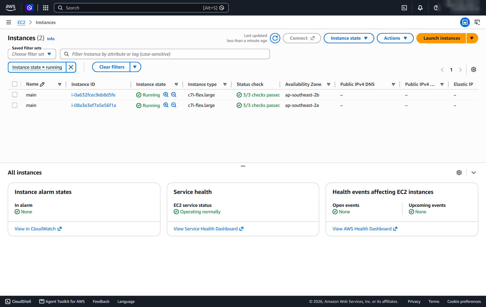<br>EKS nodes | 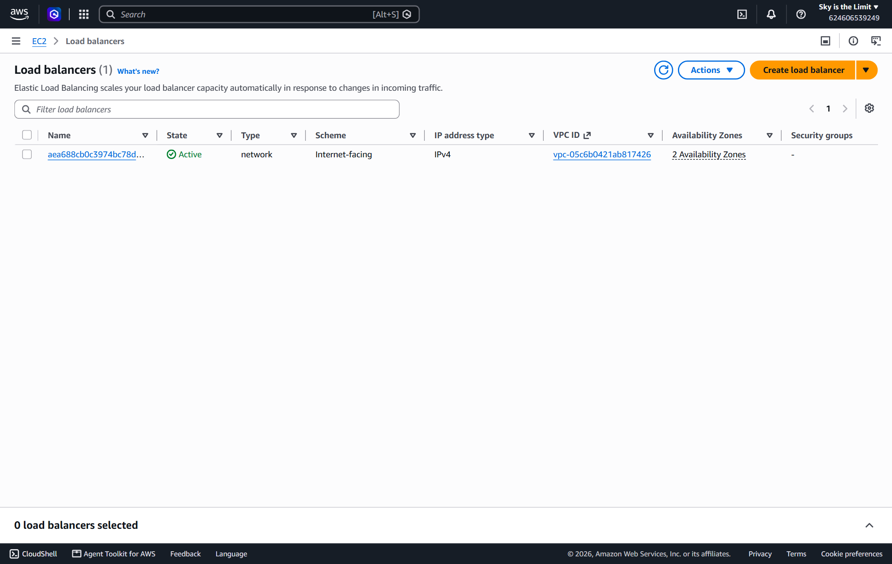<br>AWS NLB | 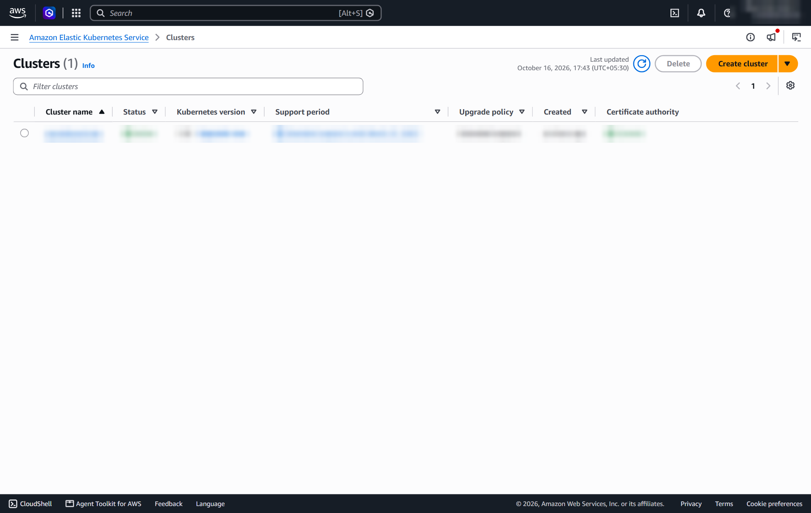<br>after destroy |

All 54 screenshots: [docs/screenshots/](docs/screenshots/).

---

<a id="lessons"></a>

## 💡 Lessons learned

The full stories, with commands and viva answers, are in [LEARNING.md](LEARNING.md). The highlights:

1. **A small node lies about its memory.** minikube reported 3.6 GiB but was capped at 2.73 GiB, so Kubernetes
   never evicted anything — it thrashed. Slimming the monitoring stack (and switching off the API server's
   high-cardinality metrics) fixed it.
2. **Readiness ≠ liveness.** Building a lab revealed the app crashed when the DB was unreachable; now it stays up,
   logs the real driver error and answers `/ready` with 503.
3. **A security scanner finds real things.** Trivy's config scan pushed the chart to read-only root filesystems
   and a locked-down EKS API.
4. **Read the error at the right layer.** EKS only said *CREATING*; the Auto Scaling group's activity log said
   *instance type not eligible for Free Tier*.
5. **Guardrails beat permissions.** An organization SCP denies even an AdministratorAccess user — the fix was to
   work within it (Sydney, Free-Tier instances, Pod Identity instead of IRSA).
6. **Delete in the right order.** Kubernetes created the load balancer and the EBS volume, so they go first;
   then `terraform destroy` runs clean.
7. **GitOps makes deployment boring.** One commit → green pipeline → deploy commit → Argo CD sync → new pods,
   with a full audit trail in git.

---

## 🧹 Cleanup

```bash
docker compose down -v                 # local stack and its database volume
minikube delete -p devops              # the local cluster
# AWS: already destroyed — see terraform/README.md for the teardown order
```

<div align="center">

Built by **Anshul Mohanty** · DevOps capstone · 2026

</div>
