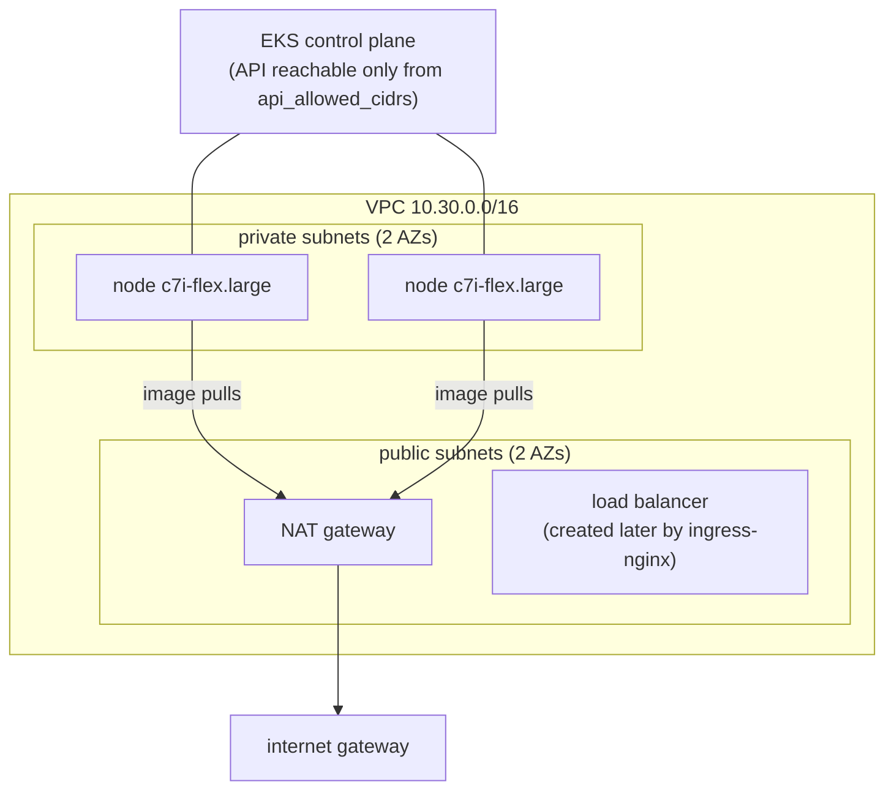

Terraform – AWS VPC + EKS
=========================

What `terraform apply` builds in `ap-southeast-2` (Sydney – the only region the AWS account's organization policy allows):



| File | Contents |
|---|---|
| `versions.tf` | Terraform ≥ 1.7, AWS provider 5.x (required by the EKS module 20.x) |
| `provider.tf` | region + default tags (`Project=foundit`) on every resource |
| `variables.tf` | region, names, versions, node size/count, **`api_allowed_cidrs` (required)** |
| `main.tf` | VPC module, EKS module (+ addons: vpc-cni, coredns, kube-proxy, EKS Pod Identity agent, EBS CSI with a gp3 default StorageClass, metrics-server), IAM role for EBS CSI via Pod Identity |
| `outputs.tf` | cluster name/endpoint, VPC + subnet IDs, NAT IP, the `aws eks update-kubeconfig` command |
| `terraform.tfvars.example` | copy to `terraform.tfvars` (git-ignored) |

## Constraints of the AWS account used

The account belongs to an AWS Organization whose policies (SCPs) shaped this setup:

| Constraint | Seen as | What the code does |
|---|---|---|
| only **ap-southeast-2** is allowed | `explicit deny in a service control policy` in every other region | `aws_region = "ap-southeast-2"` |
| account is on the **AWS Free plan** – only Free-Tier-eligible instance types launch | node group stuck in `CREATING`; ASG activity: `instance type is not eligible for Free Tier` | nodes are `c7i-flex.large` (2 vCPU / 4 GiB, Free-Tier eligible) instead of `t3.medium` |
| `iam:CreateOpenIDConnectProvider` is denied | `terraform apply` → 403 on the OIDC provider | `enable_irsa = false`; the EBS CSI driver gets its IAM role through **EKS Pod Identity** (no OIDC provider needed) |

## Cost

These are rough on-demand prices for ap-southeast-2. Check the AWS pricing pages before you start.

| Resource | ≈ per hour |
|---|---|
| EKS control plane | $0.10 |
| 2 × c7i-flex.large | $0.21 |
| NAT gateway (+ data) | $0.06 |
| load balancer (ingress-nginx) | $0.03 |
| **total** | **≈ $0.42/hour → about $1 for a 2-hour window** |

Not destroying it costs about $7 per day. Set an AWS Budget alert before you `apply`.

## The AWS window, in order

```bash
cp terraform.tfvars.example terraform.tfvars      # then set api_allowed_cidrs to YOUR_IP/32
terraform init
terraform validate
terraform plan -out tfplan                          # screenshot (M7)
terraform apply tfplan                              # ~15-20 min

aws eks update-kubeconfig --region ap-southeast-2 --name foundit-eks
kubectl get nodes

helm repo add ingress-nginx https://kubernetes.github.io/ingress-nginx
helm upgrade --install ingress-nginx ingress-nginx/ingress-nginx -n ingress-nginx --create-namespace --wait
kubectl apply -f ../k8s/namespace.yaml
helm upgrade --install foundit ../helm/foundit -n foundit \
  -f ../helm/foundit/values-eks.yaml -f ../helm/foundit/values-image.yaml --wait
kubectl get svc -n ingress-nginx ingress-nginx-controller   # EXTERNAL-IP = the ELB hostname → open it
```

## Teardown, in this order

The load balancer and the EBS volume are created **by Kubernetes**, not by Terraform. If they still
exist, `terraform destroy` hangs on the VPC: the ELB's network interfaces keep the subnets in use.

```bash
helm uninstall foundit -n foundit
kubectl delete pvc --all -n foundit          # the PVC is kept on uninstall on purpose - delete it here
helm uninstall ingress-nginx -n ingress-nginx
kubectl get svc -A | grep LoadBalancer       # must print nothing before you continue
terraform destroy                            # screenshot (M7)
```

Then check in the AWS Console (ap-southeast-2) that none of these are left: EKS clusters, EC2 instances,
NAT gateways, Elastic IPs, load balancers, EBS volumes, VPCs named `foundit-eks-vpc`.
The KMS key the EKS module created stays in "pending deletion" for 7 days. That's normal, and it
costs at most a few cents.
