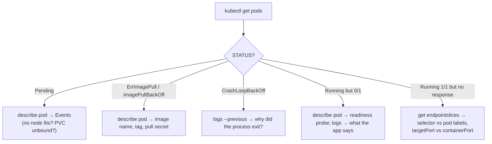

Troubleshooting labs
====================

Three things that really go wrong in Kubernetes, each as a manifest you can apply, diagnose and fix.
Every manifest has the exact commands in its header comment; the evidence is in `docs/screenshots/19-21`.
The labs run next to the real release in the `foundit` namespace and never touch it.

A curl pod makes in-cluster requests easy:

```bash
kubectl run toolbox -n foundit --image=curlimages/curl:8.11.1 --restart=Never --command -- sleep 3600
```

| Lab | Symptom | First command | Root cause | Fix |
|---|---|---|---|---|
| [broken-image.yaml](broken-image.yaml) | `ErrImagePull` → `ImagePullBackOff` | `kubectl describe pod` (Events) | tag `v1.0.O` (letter O) was never pushed | `kubectl set image … :local` |
| [broken-service.yaml](broken-service.yaml) | pods are fine, requests to the Service fail (curl exit 7) | `kubectl get endpointslices -l kubernetes.io/service-name=…` → `<unset>` | selector `component=api`, pods are `component=backend` | `kubectl patch svc … selector` |
| [broken-readiness.yaml](broken-readiness.yaml) | `0/1 Running`, **0 restarts**, never Ready | `kubectl describe pod` → readiness 503; `kubectl logs` → `password authentication failed` | hard-coded wrong DB password | `kubectl set env --from=secret/foundit-postgres` |

## The general method



## Why lab 3 matters for FoundIt

`/health` (liveness) never touches the database; `/ready` (readiness) runs a real query. So a database
problem does **not** cause a restart storm. The broken pod stays alive, out of rotation, with a clear
log line. As soon as the password is right, it becomes Ready and starts receiving traffic. The same
mechanism protects the real release when PostgreSQL is briefly unavailable.
